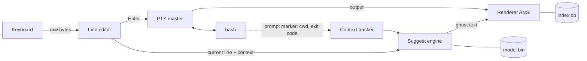

<p align="center">
  
</p>

---

<h1 align="center">KOFTERM · OFFLINE AI TERMINAL FOR LINUX</h1>

<p align="center">
  <a href="LICENSE"></a>
  <a href="https://github.com/KofLang/Kof4j"></a>
  
  
  
</p>

<p align="center">
  <a href="README.pt_BR.md">Português</a> ·
  <a href="docs/PLAN.md">Plan</a> ·
  <a href="docs/JOURNAL.md">Dev journal</a> ·
  <a href="spikes/README.md">Phase 0 results</a>
</p>

###

<h3 align="left">ABOUT:</h3>

###

<p align="left">
  KofTerm is a terminal for Linux <b>made for people learning Bash</b>. It brings the VS Code / Gemini style of autocomplete to the shell: while you type, the rest of the line appears in grey, and <b>TAB</b> accepts it.<br><br>
  The suggestion is not just a history lookup. It reads the context of the session: what you already typed, the previous command, whether it failed, the folders you visited. The more you type, the more it learns from you. Type <code>sudo apt update</code> and the next line suggests <code>sudo apt upgrade</code>. A command that fails with <i>Permission denied</i> is offered again with <code>sudo</code>. A typo like <code>gti</code> is offered as <code>git</code>.<br><br>
  Everything runs <b>locally and offline</b>. The model is trained only on Linux commands, on your own machine, and the binary never opens a network socket. If you want to help, you can send what your model learned back to the project through Git, anonymized and reviewed by you first, so every new release ships a smarter model. Nothing personal leaves your machine.<br><br>
  A side panel (<code>F1</code> / <code>Ctrl+K</code>) opens an offline index of the most common ways to use the terminal. Forgot what <code>ls -ld</code> does? Each option is explained on its own, with an example and links for further reading online, without digging through <code>--help</code>.<br><br>
  It is also my first project in <a href="https://koflang.github.io">KOF</a>, a Brazilian programming language. KOF is the heart of the project: the terminal, the AI, the training, the installer and the tests are all KOF. When the language lacks something, the answer is a new KOF library, not another language.
</p>

###

<h3 align="left">CURRENT STATUS:</h3>

###

- **Phase 0 (FFI spikes): done.** Raw keyboard mode, window size and Bash running inside a pseudo-terminal are proven in KOF native on Kali Linux. See [spikes/README.md](spikes/README.md).
- **Phase 1 (passthrough terminal): done.** `kofterm` runs Bash in a pseudo-terminal, passes Bash's exit code through, follows window resizes and restores your terminal even when killed by `SIGTERM` or `SIGHUP`.
- **Phase 2 (line editor and ghost text): next.**
- It works as a plain terminal today; the suggestions arrive in Phase 2.

###

<h3 align="left">LANGUAGES AND TOOLS:</h3>

###

<div align="left">
  
  
  
  
  
  
  
  
  
  
  
</div>

###

- **KOF 0.6.6**, native x86_64 target: small ELF binaries (~60 KB), no JVM at runtime
- **libc through KOF `extern`**: `forkpty`, `termios`, `ioctl`, `ppoll`, the only boundary outside KOF
- **SQLite** (KOF `kof.db`) for the offline command index
- **tldr-pages** (CC BY 4.0) and local `man` pages as the documentation and training corpus
- **Kali Linux** on VirtualBox as the test machine
- **Claude Code** as a pair-programming tool for research, planning and the Phase 0 spikes (disclosed in every commit)

###

<h3 align="left">FEATURES:</h3>

| Feature | Status |
| --- | --- |
| Runs Bash inside a pseudo-terminal (colors, Ctrl-C, resize, exit code) | ✅ Phase 1 |
| Terminal restored even if KofTerm is killed (`SIGTERM`, `SIGHUP`) | ✅ Phase 1 |
| Ghost-text suggestion, **TAB** accepts the line, **Ctrl+→** accepts one word | Phase 2 |
| Context-aware suggestions (what you typed, previous command, exit code, folders) | Phase 4 |
| Learns from you as you type, locally | Phase 4 |
| "Refactor" suggestions: `sudo` retry, typo fix, `cat f \| grep x` → `grep x f` | Phase 4 |
| Dangerous commands (`rm -rf /`, `mkfs`, fork bomb) flagged in red and never suggested | Phase 4 |
| Side panel / split screen with an offline command index | Phase 3 |
| Each option explained on its own (`-ld` → `-l` + `-d`), with reading links | Phase 3 |
| Opt-in, anonymized contribution of your learning back to the project via Git | Phase 5 |
| Optional tiny neural model, trained and run in pure KOF (`kof-nn`) | Phase 6 |
| One-command install from GitHub | Phase 5 |

###

<h3 align="left">HOW IT WORKS:</h3>



KofTerm owns the line you are editing, like the fish shell. When you press Enter, the line is sent to a real Bash running in a pseudo-terminal, and Bash's output is relayed back to your terminal. Suggestions are only text: nothing runs until you press Enter.

###

<h3 align="left">REPOSITORY MAP:</h3>

```text
kofterm/
├── docs/
│   ├── PLAN.md              Full plan: architecture, modules, AI, index, phases
│   ├── JOURNAL.md           Dated development journal (authorship record)
│   └── images/              Banner and screenshots
├── spikes/                  Phase 0: one folder per proof, each with main.kf
│   ├── 01_raw_keys/         Raw mode, byte-by-byte keyboard input
│   ├── 02_winsize/          Window size via ioctl(TIOCGWINSZ)
│   └── 03_pty_bash/         Bash inside a PTY with forkpty + ppoll
├── src/                     The terminal itself, all .kf
│   ├── main.kf              Event loop: keyboard, Bash output and signals
│   ├── libc.kf              Every libc extern and Linux constant, in one place
│   ├── tty.kf               Raw mode, restore, window size (future kof-tty)
│   ├── pty.kf               Bash in a pseudo-terminal, exit status (future kof-tty)
│   └── sig.kf               Signals read as data through signalfd (future kof-tty)
├── AUTHORS.md               Author and credits
├── CHANGELOG.md             Versioned changes
├── CITATION.cff             How to cite this project
├── LICENSE                  GNU GPL v3
└── NOTICE                   Third-party credits and licenses
```

###

<h3 align="left">GETTING STARTED:</h3>

**Requirements:** Linux x86_64 with glibc 2.34 or newer (for `forkpty` in `libc.so.6`) and KOF 0.6.6.

**1. Install KOF.** Download `kof-0.6.6-linux-x86_64.tar.gz` and `SHA256SUMS` from the [KOF releases](https://github.com/KofLang/Kof4j/releases), check the hash and extract:

```bash
sha256sum -c SHA256SUMS --ignore-missing
```
```bash
mkdir -p ~/.local/share ~/.local/bin && tar -xzf kof-0.6.6-linux-x86_64.tar.gz -C ~/.local/share && mv ~/.local/share/kof-0.6.6-linux-x86_64 ~/.local/share/kof && ln -sf ~/.local/share/kof/bin/kof ~/.local/bin/kof
```

**2. Clone this repository.**

```bash
git clone https://github.com/DATAdotPDF/kofterm.git && cd kofterm
```

**3. Build and run KofTerm** (Phase 1, passthrough):

```bash
kof build src --target native --output build/kofterm
```
```bash
./build/kofterm/Default/Main
```

You get your Bash inside KofTerm (`echo $KOFTERM` prints `1`). Type `exit` to come back; KofTerm exits with the same code as Bash.

**4. Optional: run the Phase 0 spikes** (in a real terminal window, not through a pipe):

```bash
cd spikes/02_winsize && kof run main.kf --target=native
```
```bash
cd ../01_raw_keys && kof run main.kf --target=native
```
```bash
cd ../03_pty_bash && kof run main.kf --target=native
```

Spike 01 prints every key you press (`q` quits). Spike 03 opens a Bash inside KofTerm's pseudo-terminal; type `exit` to come back. If a terminal is ever left in a strange state, `reset` fixes it.

###

<h3 align="left">ROADMAP:</h3>

| Phase | Goal | Status |
| --- | --- | --- |
| 0 | FFI spikes: raw mode, window size, PTY | ✅ done (21/10/2026) |
| 1 | Passthrough terminal, signal-safe restore (`signalfd`) | ✅ done (21/10/2026) |
| 2 | Line editor and ghost text from history | next |
| 3 | Offline command index, side panel, per-option explanations, reading links | planned |
| 4 | n-gram model with local continuous learning, context, grammar, safety rules | planned |
| 5 | `kofterm contribute` (anonymized, opt-in), installer, CI with "no network" check, first release | planned |
| 6 | Optional neural model in pure KOF (`kof-nn`) | planned |

Parallel KOF libraries that will be extracted along the way: `kof-tty` (terminal and PTY), `kof-ansi` (keys and screen), `kof-nn` (tensors and a tiny transformer).

###

<h3 align="left">END-TO-END PROCESS:</h3>

###

**1. Idea.** VS Code with Gemini suggests the rest of a line and TAB accepts it. I wanted the same in the Linux terminal, but local, private and limited to Linux commands, with a cheat sheet always one keystroke away.

**2. Research.** I studied the KOF language site, its standard library and targets, the `training/` corpus of the [KOF central repository](https://github.com/KofLang/Kof4j), and [koffuster](https://github.com/lunalully/koffuster), a terminal tool written in KOF, as a reference for project layout.

**3. Scope decisions.** A full graphical terminal emulator was out of scope for a first project, so KofTerm is a terminal front-end that runs inside any existing terminal. Target: KOF native, the closest thing to a regular Linux binary. AI: an n-gram model first, an optional neural model later. Documentation: tldr-pages and local `man` pages, with SS64 kept as links only because its content is copyrighted.

**4. The KOF-only rule.** The first plan used Python for training and a C helper as a fallback. I rejected that: KOF is the heart of the project, and anything missing becomes a parallel KOF library. That keeps the whole loop auditable and inside one language.

**5. Test machine.** KOF 0.6.6 was installed on a Kali Linux VM from the official release, with the SHA-256 checked. The VM is reached over SSH with a dedicated key.

**6. Phase 0 findings.** All three spikes passed after fixing what the docs did not say. KOF has no file-level constants (they live as `static` fields in a class). `Buffer(U8)` cannot be a function parameter, so memory is handled as raw `Long` pointers from `malloc`. An `extern` named `poll` is silently routed to KOF's own concurrency `poll`, so the terminal uses `ppoll`. Details in [spikes/README.md](spikes/README.md).

**7. Phase 1: a real terminal.** The spike became `src/`, split into modules that will later form the `kof-tty` library. Signals are blocked and read as data through `signalfd` in the same `ppoll` loop, because KOF cannot keep a signal callback. That gives resize on `SIGWINCH` and a restored terminal on `SIGTERM` and `SIGHUP`. Verified on Kali: Bash's exit code passes through (`exit 7` → 7), and no orphan Bash is left behind.

**8. Learning that comes back.** The model learns from each user locally. Users who want to help can export an anonymized file (paths, hosts, users and numbers become placeholders, and anything that looks like a secret is dropped), review it, and send it as a pull request. CI checks it again and retrains the base model, so each release ships a smarter one. KofTerm itself never touches the network: the user's own Git does the sending.

The full, dated log is in [docs/JOURNAL.md](docs/JOURNAL.md).

###

<h3 align="left">SECURITY AND PRIVACY:</h3>

- No network code: the source never imports `kof.web`, `kof.net` or `http`, and CI will fail if it does
- A `kofterm doctor` check will confirm zero network syscalls with `strace`
- Suggestions never execute anything: only Enter runs a command
- History and the trained model stay in `~/.local/share/kofterm`, readable only by you
- Contribution is opt-in, shown to you in full before sending, anonymized twice (on your machine and again in CI), and sent by your own Git, never by KofTerm
- Reading links in the side panel are only displayed; KofTerm never opens them
- Dependencies are limited to the KOF standard library and this project's own KOF libraries, with pinned versions

###

<h3 align="left">CREDITS:</h3>

- **KOF language:** created by **Mel Santos** ([@melmonfre](https://github.com/melmonfre) · [LinkedIn](https://www.linkedin.com/in/aminadojava/)) and maintained with the KOF contributors in the central repository **[KofLang/Kof4j](https://github.com/KofLang/Kof4j)**, licensed GPL-3.0. Site: [koflang.github.io](https://koflang.github.io). The KOF logo shown above belongs to the KOF project.
- **koffuster** by [Luna (@lunalully)](https://github.com/lunalully/koffuster): reference for structuring a KOF terminal tool.
- **tldr-pages** ([tldr-pages/tldr](https://github.com/tldr-pages/tldr)), CC BY 4.0: command examples for the index and the training corpus.
- **SS64** ([ss64.com/bash](https://ss64.com/bash/)): command reference. Its content is not copied into this repository; KofTerm links to it.

Full third-party notices in [NOTICE](NOTICE).

###

<h3 align="left">AUTHORSHIP:</h3>

KofTerm was conceived and is developed by **Pedro D. Ferreira** ([@DATAdotPDF](https://github.com/DATAdotPDF)). The project's authorship is recorded in its Git history, in the dated [development journal](docs/JOURNAL.md) and in [AUTHORS.md](AUTHORS.md). AI assistance (Claude Code) is disclosed with a `Co-Authored-By` line in each commit it helped produce.

To cite KofTerm, use [CITATION.cff](CITATION.cff).

###

<h3 align="left">LICENSE:</h3>

GNU General Public License v3.0, the same license as KOF. See [LICENSE](LICENSE).

## Connect

[](https://portfolio-data-cybersecurity.data-pedutraferreira.workers.dev)
[](https://www.linkedin.com/in/data-pdf/)
[](https://github.com/DATAdotPDF)
[](mailto:data.pedutraferreira@gmail.com)

<p align="center">
  From audiovisual storytelling to reliable data and security systems.
</p>
