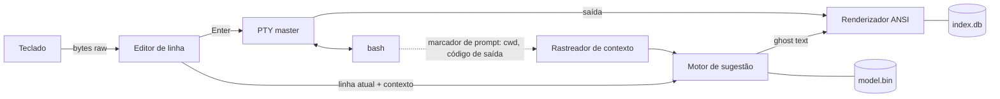

<p align="center">
  
</p>

---

<h1 align="center">KOFTERM · TERMINAL COM IA OFFLINE PARA LINUX</h1>

<p align="center">
  <a href="LICENSE"></a>
  <a href="https://github.com/KofLang/Kof4j"></a>
  
  
  
</p>

<p align="center">
  <a href="README.md">English</a> ·
  <a href="docs/PLAN.md">Plano</a> ·
  <a href="docs/JOURNAL.md">Diário de desenvolvimento</a> ·
  <a href="spikes/README.md">Resultados da Fase 0</a>
</p>

###

<h3 align="left">SOBRE:</h3>

###

<p align="left">
  O KofTerm é um terminal para Linux que traz para o Bash o autocomplete no estilo VS Code / Gemini: enquanto você digita, o resto da linha aparece em cinza, e o <b>TAB</b> aceita.<br><br>
  A sugestão não é só uma busca no histórico. Ela lê o contexto da sessão: o comando anterior, se ele falhou, a pasta atual. Digite <code>sudo apt update</code> e a próxima linha sugere <code>sudo apt upgrade</code>. Um comando que falha com <i>Permission denied</i> é oferecido de novo com <code>sudo</code>. Um erro de digitação como <code>gti</code> vira <code>git</code>.<br><br>
  Tudo roda <b>localmente e offline</b>. O modelo é treinado só com comandos Linux, na sua própria máquina, e o binário nunca abre um socket de rede. Um painel lateral (<code>F1</code> / <code>Ctrl+K</code>) abre um índice offline de comandos, com explicações e exemplos: esquecer um comando custa uma tecla.<br><br>
  É também o meu primeiro projeto em <a href="https://koflang.github.io">KOF</a>, uma linguagem de programação brasileira. KOF é o coração do projeto: o terminal, a IA, o treino, o instalador e os testes são todos em KOF. Quando faltar algo na linguagem, a resposta é uma nova biblioteca KOF, não outra linguagem.
</p>

###

<h3 align="left">STATUS ATUAL:</h3>

###

- **Fase 0 (spikes de FFI): concluída.** Modo raw do teclado, tamanho da janela e Bash rodando dentro de um pseudo-terminal estão provados em KOF native no Kali Linux. Veja [spikes/README.md](spikes/README.md).
- **Fase 1 (terminal passthrough): próxima.**
- Ainda não serve como terminal do dia a dia.

###

<h3 align="left">LINGUAGENS E FERRAMENTAS:</h3>

###

<div align="left">
  
  
  
  
  
  
  
  
  
  
  
</div>

###

- **KOF 0.6.6**, target native x86_64: binários ELF pequenos (~60 KB), sem JVM em tempo de execução
- **libc via `extern` do KOF**: `forkpty`, `termios`, `ioctl`, `ppoll`, a única fronteira fora do KOF
- **SQLite** (`kof.db` do KOF) para o índice offline de comandos
- **tldr-pages** (CC BY 4.0) e páginas `man` locais como corpus de documentação e de treino
- **Kali Linux** no VirtualBox como máquina de testes
- **Claude Code** como ferramenta de pair programming na pesquisa, no planejamento e nos spikes da Fase 0 (declarado em cada commit)

###

<h3 align="left">FUNCIONALIDADES:</h3>

| Funcionalidade | Status |
| --- | --- |
| Bash dentro de um pseudo-terminal (cores, `vim`, `htop`, Ctrl-C, redimensionar) | ✅ provado no spike 03, acabamento na Fase 1 |
| Sugestão em ghost text, **TAB** aceita a linha, **Ctrl+→** aceita uma palavra | Fase 2 |
| Sugestões com contexto (comando anterior, código de saída, pasta) | Fase 4 |
| Sugestões de "refatoração": repetir com `sudo`, corrigir typo, `cat f \| grep x` → `grep x f` | Fase 4 |
| Comandos perigosos (`rm -rf /`, `mkfs`, fork bomb) marcados em vermelho e nunca sugeridos | Fase 4 |
| Painel lateral / tela dividida com índice offline de comandos | Fase 3 |
| Modelo n-gram local treinado só com comandos Linux | Fase 4 |
| Modelo neural pequeno opcional, treinado e executado em KOF puro (`kof-nn`) | Fase 6 |
| Instalação com um comando a partir do GitHub | Fase 5 |

###

<h3 align="left">COMO FUNCIONA:</h3>



O KofTerm controla a linha que você está editando, como o fish shell. Quando você aperta Enter, a linha vai para um Bash de verdade rodando num pseudo-terminal, e a saída do Bash volta para o seu terminal. Sugestões são só texto: nada roda antes do Enter.

###

<h3 align="left">MAPA DO REPOSITÓRIO:</h3>

```text
kofterm/
├── docs/
│   ├── PLAN.md              Plano completo: arquitetura, módulos, IA, índice, fases
│   ├── JOURNAL.md           Diário de desenvolvimento datado (registro de autoria)
│   └── images/              Banner e capturas de tela
├── spikes/                  Fase 0: uma pasta por prova, cada uma com main.kf
│   ├── 01_raw_keys/         Modo raw, leitura do teclado byte a byte
│   ├── 02_winsize/          Tamanho da janela via ioctl(TIOCGWINSZ)
│   └── 03_pty_bash/         Bash dentro de um PTY com forkpty + ppoll
├── src/                     (Fase 1+) o terminal em si, todo em .kf
├── AUTHORS.md               Autor e créditos
├── CHANGELOG.md             Mudanças por versão
├── CITATION.cff             Como citar o projeto
├── LICENSE                  GNU GPL v3
└── NOTICE                   Créditos e licenças de terceiros
```

###

<h3 align="left">COMO COMEÇAR:</h3>

**Requisitos:** Linux x86_64 com glibc 2.34 ou mais nova (por causa do `forkpty` na `libc.so.6`) e KOF 0.6.6.

**1. Instale o KOF.** Baixe `kof-0.6.6-linux-x86_64.tar.gz` e `SHA256SUMS` das [releases do KOF](https://github.com/KofLang/Kof4j/releases), confira o hash e extraia:

```bash
sha256sum -c SHA256SUMS --ignore-missing
```
```bash
mkdir -p ~/.local/share ~/.local/bin && tar -xzf kof-0.6.6-linux-x86_64.tar.gz -C ~/.local/share && mv ~/.local/share/kof-0.6.6-linux-x86_64 ~/.local/share/kof && ln -sf ~/.local/share/kof/bin/kof ~/.local/bin/kof
```

**2. Clone este repositório.**

```bash
git clone https://github.com/DATAdotPDF/kofterm.git && cd kofterm
```

**3. Rode os spikes da Fase 0** (numa janela de terminal de verdade, não por pipe):

```bash
cd spikes/02_winsize && kof run main.kf --target=native
```
```bash
cd ../01_raw_keys && kof run main.kf --target=native
```
```bash
cd ../03_pty_bash && kof run main.kf --target=native
```

O spike 01 mostra cada tecla que você aperta (`q` sai). O spike 03 abre um Bash dentro do pseudo-terminal do KofTerm; digite `exit` para voltar. Se o terminal ficar estranho, `reset` resolve.

###

<h3 align="left">ROADMAP:</h3>

| Fase | Objetivo | Status |
| --- | --- | --- |
| 0 | Spikes de FFI: modo raw, tamanho da janela, PTY | ✅ concluída (21/10/2026) |
| 1 | Terminal passthrough, restauração segura em sinais (`signalfd`) | próxima |
| 2 | Editor de linha e ghost text a partir do histórico | planejada |
| 3 | Índice offline de comandos e painel lateral | planejada |
| 4 | Modelo n-gram, contexto, gramática, regras de segurança | planejada |
| 5 | Instalador, CI com checagem de "sem rede", primeira release | planejada |
| 6 | Modelo neural opcional em KOF puro (`kof-nn`) | planejada |

Bibliotecas KOF paralelas que serão extraídas no caminho: `kof-tty` (terminal e PTY), `kof-ansi` (teclas e tela), `kof-nn` (tensores e um transformer pequeno).

###

<h3 align="left">PROCESSO DE PONTA A PONTA:</h3>

###

**1. Ideia.** O VS Code com o Gemini sugere o resto da linha e o TAB aceita. Eu queria o mesmo no terminal Linux, mas local, privado e restrito a comandos Linux, com uma cola sempre a uma tecla de distância.

**2. Pesquisa.** Estudei o site da linguagem KOF, a biblioteca padrão e os targets, o corpus `training/` do [repositório central do KOF](https://github.com/KofLang/Kof4j) e o [koffuster](https://github.com/lunalully/koffuster), uma ferramenta de terminal escrita em KOF, como referência de estrutura.

**3. Decisões de escopo.** Um emulador de terminal gráfico completo estava fora do escopo de um primeiro projeto, então o KofTerm é um front-end que roda dentro de qualquer terminal existente. Target: KOF native, o mais próximo de um binário Linux comum. IA: primeiro um modelo n-gram, depois um modelo neural opcional. Documentação: tldr-pages e `man` local, com o SS64 apenas como links, porque o conteúdo dele tem copyright.

**4. A regra "só KOF".** O primeiro plano usava Python no treino e um helper em C como alternativa. Eu recusei: KOF é o coração do projeto, e o que faltar vira uma biblioteca KOF paralela. Assim o ciclo inteiro fica auditável e dentro de uma só linguagem.

**5. Máquina de testes.** O KOF 0.6.6 foi instalado numa VM Kali Linux a partir da release oficial, com o SHA-256 conferido. A VM é acessada por SSH com uma chave dedicada.

**6. Achados da Fase 0.** Os três spikes passaram depois de corrigir o que a documentação não dizia. O KOF não tem constantes no nível do arquivo (elas ficam como campos `static` numa classe). `Buffer(U8)` não pode ser parâmetro de função, então a memória é tratada como ponteiros `Long` crus vindos de `malloc`. Um `extern` chamado `poll` é desviado em silêncio para o `poll` de concorrência do próprio KOF, então o terminal usa `ppoll`. Detalhes em [spikes/README.md](spikes/README.md).

O registro completo e datado está em [docs/JOURNAL.md](docs/JOURNAL.md).

###

<h3 align="left">SEGURANÇA E PRIVACIDADE:</h3>

- Sem código de rede: o código-fonte nunca importa `kof.web`, `kof.net` ou `http`, e o CI vai falhar se importar
- Um `kofterm doctor` vai confirmar zero chamadas de rede com `strace`
- Sugestões nunca executam nada: só o Enter roda um comando
- Histórico e modelo treinado ficam em `~/.local/share/kofterm`, legíveis só por você
- Dependências limitadas à biblioteca padrão do KOF e às bibliotecas KOF do próprio projeto, com versões fixas

###

<h3 align="left">CRÉDITOS:</h3>

- **Linguagem KOF:** criada por **Mel Santos** ([@melmonfre](https://github.com/melmonfre) · [LinkedIn](https://www.linkedin.com/in/aminadojava/)) e mantida com os contribuidores do KOF no repositório central **[KofLang/Kof4j](https://github.com/KofLang/Kof4j)**, sob GPL-3.0. Site: [koflang.github.io](https://koflang.github.io). O logo do KOF mostrado acima pertence ao projeto KOF.
- **koffuster**, de [Luna (@lunalully)](https://github.com/lunalully/koffuster): referência de estrutura de uma ferramenta de terminal em KOF.
- **tldr-pages** ([tldr-pages/tldr](https://github.com/tldr-pages/tldr)), CC BY 4.0: exemplos de comandos para o índice e o corpus de treino.
- **SS64** ([ss64.com/bash](https://ss64.com/bash/)): referência de comandos. O conteúdo não é copiado para este repositório; o KofTerm usa links.

Avisos completos de terceiros em [NOTICE](NOTICE).

###

<h3 align="left">AUTORIA:</h3>

O KofTerm foi concebido e é desenvolvido por **Pedro D. Ferreira** ([@DATAdotPDF](https://github.com/DATAdotPDF)). A autoria está registrada no histórico do Git, no [diário de desenvolvimento](docs/JOURNAL.md) datado e em [AUTHORS.md](AUTHORS.md). A assistência de IA (Claude Code) é declarada com uma linha `Co-Authored-By` em cada commit em que ela ajudou.

Para citar o KofTerm, use o [CITATION.cff](CITATION.cff).

###

<h3 align="left">LICENÇA:</h3>

GNU General Public License v3.0, a mesma licença do KOF. Veja [LICENSE](LICENSE).

## Contato

[](https://portfolio-data-cybersecurity.data-pedutraferreira.workers.dev)
[](https://www.linkedin.com/in/data-pdf/)
[](https://github.com/DATAdotPDF)
[](mailto:data.pedutraferreira@gmail.com)

<p align="center">
  Do storytelling audiovisual a sistemas confiáveis de dados e segurança.
</p>
