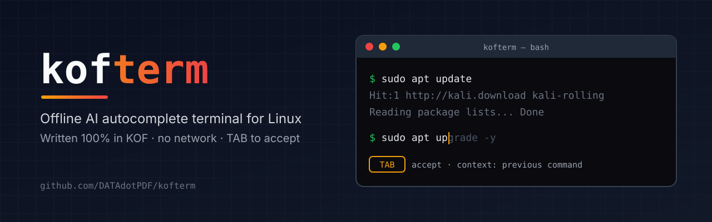
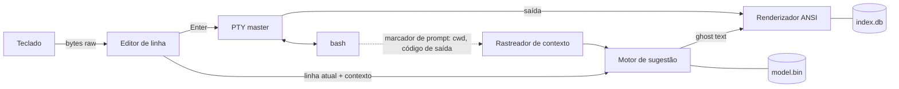

<p align="center">
  
</p>

---

<h1 align="center">KOFTERM · TERMINAL COM IA OFFLINE PARA LINUX</h1>

<p align="center">
  <a href="LICENSE"></a>
  <a href="https://github.com/KofLang/Kof4j"></a>
  
  
  <a href="https://github.com/DATAdotPDF/kofterm/releases"></a>
  <a href="https://github.com/DATAdotPDF/kofterm/actions/workflows/ci.yml"></a>
</p>

<p align="center">
  <a href="README.md">English</a> ·
  <a href="docs/PLAN.md">Plano</a> ·
  <a href="docs/JOURNAL.md">Diário de desenvolvimento</a> ·
  <a href="spikes/README.md">Resultados da Fase 0</a>
</p>

###

<h3 align="left">SOBRE:</h3>

###

<p align="left">
  O KofTerm é um terminal para Linux <b>feito para quem está estudando Bash</b>. Ele traz para o shell o autocomplete no estilo VS Code / Gemini: enquanto você digita, o resto da linha aparece em cinza, e o <b>TAB</b> aceita.<br><br>
  A sugestão não é só uma busca no histórico. Ela lê o contexto da sessão: o que você já escreveu, o comando anterior, se ele falhou, as pastas que você visitou. Quanto mais você digita, mais ele aprende com você. Digite <code>sudo apt update</code> e a próxima linha sugere <code>sudo apt upgrade</code>. Um comando que falha com <i>Permission denied</i> é oferecido de novo com <code>sudo</code>. Um erro de digitação como <code>gti</code> vira <code>git</code>.<br><br>
  Tudo roda <b>localmente e offline</b>. O modelo é treinado só com comandos Linux, na sua própria máquina, e o binário nunca abre um socket de rede. Se você quiser ajudar, pode devolver ao projeto, pelo Git, o que o seu modelo aprendeu, anonimizado e revisado por você antes, para que cada versão nova traga um modelo mais inteligente. Nada pessoal sai da sua máquina.<br><br>
  Uma aba de índice (<code>F1</code>) e um painel ao vivo embaixo da tela (<code>F2</code>) cobrem as formas mais conhecidas de usar o terminal. Esqueceu o que <code>ls -ld</code> faz? Cada opção é explicada separadamente, com exemplo e indicações de leitura online, sem precisar garimpar o <code>--help</code>.<br><br>
  É também o meu primeiro projeto em <a href="https://koflang.github.io">KOF</a>, uma linguagem de programação brasileira. KOF é o coração do projeto: o terminal, a IA, o treino, o instalador e os testes são todos em KOF. Quando faltar algo na linguagem, a resposta é uma nova biblioteca KOF, não outra linguagem.
</p>

###

<h3 align="left">STATUS ATUAL:</h3>

###

- **Fase 0 (spikes de FFI): concluída.** Modo raw do teclado, tamanho da janela e Bash rodando dentro de um pseudo-terminal estão provados em KOF native no Kali Linux. Veja [spikes/README.md](spikes/README.md).
- **Fase 1 (terminal passthrough): concluída.** O `kofterm` roda o Bash num pseudo-terminal, repassa o código de saída do Bash, acompanha o redimensionamento da janela e restaura o seu terminal mesmo quando é morto por `SIGTERM` ou `SIGHUP`.
- **Fase 2 (editor de linha e ghost text): concluída.** No prompt, o KofTerm edita a linha e mostra em cinza o resto de um comando do seu histórico que combina com o que você digitou. **TAB** ou **→** aceita, **Ctrl+→** aceita uma palavra, e ↑/↓ navegam no histórico.
- **Fase 3 (índice offline e painel): concluída.** **F1** ou **Ctrl+T** abre uma aba em tela cheia com o índice e busca; **F2** divide a tela e mantém embaixo uma explicação ao vivo do que você está digitando. `ls -ld` mostra `-l` e `-d` explicados um a um, com exemplos e links de leitura.
- **Fase 4 (o modelo que entende contexto): concluída.** A sugestão em cinza agora vem de um modelo local que aprende com cada comando que você roda: usa o que você digitou, o comando anterior, o tipo de pasta em que você está e quão recente é cada comando. Na linha vazia ele prevê o próximo comando, oferece `sudo` depois de "Permissão negada" e corrige o nome depois de "comando não encontrado". Também completa arquivos, pastas e opções, e nunca sugere comandos perigosos.
- **Fase 5 (contribuição, instalador, primeira release): concluída.** `kofterm contribute` exporta o que o seu modelo aprendeu, anonimizado na sua máquina, para você revisar e enviar por pull request; o CI valida cada contribuição e a próxima versão aprende com ela. Instalação com um comando, pela release ou pelo código. **Primeira release: v0.5.0.**
- **Próximos passos:** mais entradas no índice (importar tldr e o `man` local), índice em inglês, lista de candidatos ao completar arquivos, modelo neural opcional em KOF puro (`kof-nn`).

###

<h3 align="left">LINGUAGENS E FERRAMENTAS:</h3>

###

<div align="left">
  
  
  
  
  
  
  
  
  
  
  
</div>

###

- **KOF 0.6.6**, target native x86_64: binários ELF pequenos (~60 KB), sem JVM em tempo de execução
- **libc via `extern` do KOF**: `forkpty`, `termios`, `ioctl`, `ppoll`, a única fronteira fora do KOF
- **SQLite** (`kof.db` do KOF) para o índice offline de comandos
- **tldr-pages** (CC BY 4.0) e páginas `man` locais como corpus de documentação e de treino
- **Kali Linux** no VirtualBox como máquina de testes
- **Claude Code** como ferramenta de pair programming na pesquisa, no planejamento e nos spikes da Fase 0 (declarado em cada commit)

###

<h3 align="left">FUNCIONALIDADES:</h3>

| Funcionalidade | Status |
| --- | --- |
| Bash dentro de um pseudo-terminal (cores, Ctrl-C, redimensionar, código de saída) | ✅ Fase 1 |
| Terminal restaurado mesmo se o KofTerm for morto (`SIGTERM`, `SIGHUP`) | ✅ Fase 1 |
| Sugestão em ghost text, **TAB** / **→** aceita a linha, **Ctrl+→** aceita uma palavra | ✅ Fase 2 |
| Edição de linha: ←/→, Home/End, Ctrl-A/E/U/K/W, Ctrl-L, histórico com ↑/↓, UTF-8 (acentos) | ✅ Fase 2 |
| Histórico privado em `~/.local/share/kofterm` (pasta 0700, arquivos 0600) | ✅ Fase 2 |
| Sugestões com contexto (o que você digitou, comando anterior, código de saída, tipo de pasta) | ✅ Fase 4 |
| Linha vazia prevê o próximo comando (`sudo apt update` → `sudo apt upgrade`) | ✅ Fase 4 |
| Aprende com você conforme você roda comandos, localmente, desde a primeira repetição | ✅ Fase 4 |
| Correções depois de erros: `sudo` após "Permissão negada", nome certo após "comando não encontrado" | ✅ Fase 4 |
| Completa arquivos, pastas (`/etc/hostn` → `ame`) e opções (`ls --a` → `ll`) | ✅ Fase 4 |
| Comandos perigosos (`rm -rf /`, `mkfs`, `dd of=/dev/sd…`, fork bomb) em vermelho e nunca sugeridos | ✅ Fase 4 |
| Aba do índice em tela cheia com busca (**F1** / **Ctrl+T**), 53 entradas em português | ✅ Fase 3 |
| Tela dividida com explicação ao vivo da linha atual (**F2**, lembrado) | ✅ Fase 3 |
| Cada opção explicada separadamente (`-ld` → `-l` + `-d`), com exemplos e links de leitura | ✅ Fase 3 |
| Contribuição opcional e anonimizada do aprendizado de volta ao projeto via Git | ✅ Fase 5 |
| Modelo neural pequeno opcional, treinado e executado em KOF puro (`kof-nn`) | Fase 6 |
| Instalação com um comando, pela release ou pelo código; `doctor` e `uninstall` | ✅ Fase 5 |

###

<h3 align="left">COMO FUNCIONA:</h3>



O KofTerm controla a linha que você está editando, como o fish shell. Quando você aperta Enter, a linha vai para um Bash de verdade rodando num pseudo-terminal, e a saída do Bash volta para o seu terminal. Sugestões são só texto: nada roda antes do Enter.

###

<h3 align="left">MAPA DO REPOSITÓRIO:</h3>

```text
kofterm/
├── docs/
│   ├── PLAN.md              Plano completo: arquitetura, módulos, IA, índice, fases
│   ├── JOURNAL.md           Diário de desenvolvimento datado (registro de autoria)
│   └── images/              Banner e capturas de tela
├── .github/workflows/ci.yml Testes, build nativo, checagem de "sem rede", validação das contribuições
├── corpus/
│   ├── sessions.txt         Sequências iniciais de comandos, para as sugestões funcionarem no primeiro dia
│   └── commands.txt         Lista pública de nomes de comandos (só eles passam pelo anonimizador)
├── datasets/contrib/        Contribuições anonimizadas da comunidade (.kofdata)
├── index/
│   └── pt_BR.txt            O índice offline de comandos, escrito pelo projeto (veja abaixo)
├── spikes/                  Fase 0: uma pasta por prova, cada uma com main.kf
│   ├── 01_raw_keys/         Modo raw, leitura do teclado byte a byte
│   ├── 02_winsize/          Tamanho da janela via ioctl(TIOCGWINSZ)
│   └── 03_pty_bash/         Bash dentro de um PTY com forkpty + ppoll
├── src/                     O terminal em si, todo em .kf
│   ├── main.kf              Laço de eventos: teclado, saída do Bash e sinais
│   ├── session.kf           No prompt: edição da linha, ghost text, envio ao Bash
│   ├── keys.kf              Bytes crus → teclas, com testes (futura kof-ansi)
│   ├── editor.kf            A linha sendo digitada e o cursor, com testes
│   ├── history.kf           Histórico e sugestões, com testes
│   ├── prompt.kf            Acha o marcador invisível de prompt na saída do Bash, com testes
│   ├── index.kf             Formato do índice, busca e separação de opções (-ld → -l, -d), com testes
│   ├── model.kf             O modelo que aprende, regras de segurança, correção de typo, mapa próprio, com testes
│   ├── brain.kf             Liga o modelo à pasta, aos arquivos, às opções e aos seus eventos
│   ├── anon.kf              Anonimizador e validador das contribuições, com testes
│   ├── cli.kf               Subcomandos: contribute, check, install, uninstall, doctor
│   ├── tab.kf               A aba do índice em tela cheia (F1 / Ctrl+T)
│   ├── storage.kf           Arquivos privados, conversões UTF-8, o bashrc do KofTerm
│   ├── 00_libc.kf           Todos os extern da libc e constantes do Linux; nome para compilar primeiro (veja o diário)
│   ├── tty.kf               Modo raw, restauração, tamanho da janela (futura kof-tty)
│   ├── pty.kf               Bash num pseudo-terminal, código de saída (futura kof-tty)
│   └── sig.kf               Sinais lidos como dados via signalfd (futura kof-tty)
├── AUTHORS.md               Autor e créditos
├── CHANGELOG.md             Mudanças por versão
├── CITATION.cff             Como citar o projeto
├── LICENSE                  GNU GPL v3
├── NOTICE                   Créditos e licenças de terceiros
└── install.sh               Bootstrap: obtém o KOF se faltar (SHA-256 fixo), compila, roda kofterm install
```

###

<h3 align="left">COMO COMEÇAR:</h3>

**Requisitos:** Linux x86_64 com glibc 2.34 ou mais nova (Ubuntu 22.04+, Debian 12+, Fedora 35+, Kali). O binário depende só da `libc` do sistema.

**Opção A: release pronta (sem precisar do KOF).** Baixe `kofterm-0.5.0-linux-x86_64.tar.gz` e `SHA256SUMS` da [página de releases](https://github.com/DATAdotPDF/kofterm/releases) e rode:

```bash
sha256sum -c SHA256SUMS --ignore-missing
```
```bash
tar -xzf kofterm-0.5.0-linux-x86_64.tar.gz && ./kofterm-0.5.0-linux-x86_64/kofterm install
```

**Opção B: a partir do código.** O `install.sh` compila o KofTerm com o KOF 0.6.6. Se o KOF faltar, ele pergunta antes de baixar a release oficial (cerca de 370 MB) e confere o SHA-256, que está fixado no script.

```bash
git clone https://github.com/DATAdotPDF/kofterm.git && cd kofterm && ./install.sh
```

As duas instalam em `~/.local/share/kofterm` e criam o comando `kofterm` em `~/.local/bin`. Depois é só abrir:

```bash
kofterm
```

Você cai no seu Bash dentro do KofTerm (`echo $KOFTERM` mostra `1`). Digite `exit` para voltar; o KofTerm sai com o mesmo código do Bash.

| Comando | O que faz |
| --- | --- |
| `kofterm` | Abre o terminal |
| `kofterm contribute --preview` | Mostra o que seria compartilhado com o projeto. Nada é gravado |
| `kofterm contribute` | Grava `kofterm-contrib.kofdata` na pasta atual, para você revisar e enviar |
| `kofterm check ARQUIVO...` | Valida arquivos `.kofdata` (usado no CI) |
| `kofterm doctor` | Confere a instalação e mostra onde ficam seus dados |
| `kofterm uninstall` | Remove o programa e mantém seu histórico; `--purge` remove tudo |

Para abrir o KofTerm sozinho em todo terminal novo, coloque no fim do `~/.bashrc` (a checagem do `KOFTERM` impede que ele abra dentro de si mesmo):

```bash
[ -z "$KOFTERM" ] && command -v kofterm >/dev/null && exec kofterm
```

| Tecla | O que faz |
| --- | --- |
| **TAB** ou **→** | Aceita a sugestão em cinza |
| **Ctrl+→** | Aceita uma palavra da sugestão |
| **↑ / ↓** | Comando anterior / próximo |
| **F1** ou **Ctrl+T** | Abre a aba do índice, direto no comando que você está digitando. Digite para buscar, Enter abre, Esc volta |
| **F2** | Divide a tela: explicação ao vivo da linha atual embaixo (lembrado na próxima vez) |
| **Ctrl-L** | Limpa a tela e mantém o que você estava digitando |

**Para quem desenvolve.** Compile e rode a partir do repositório sem instalar, e rode os testes unitários (47 testes, um arquivo por vez):

```bash
kof build src --target native --output build/kofterm && ./build/kofterm/Default/Main
```
```bash
for f in keys editor history prompt index model anon; do kof test src/$f.kf --target native; done
```

Opcional, os spikes da Fase 0 (numa janela de terminal de verdade, não por pipe):

```bash
cd spikes/02_winsize && kof run main.kf --target=native
```
```bash
cd ../01_raw_keys && kof run main.kf --target=native
```
```bash
cd ../03_pty_bash && kof run main.kf --target=native
```

O spike 01 mostra cada tecla que você aperta (`q` sai). O spike 03 abre um Bash dentro do pseudo-terminal do KofTerm; digite `exit` para voltar. Se o terminal ficar estranho, `reset` resolve.

###

<h3 align="left">ROADMAP:</h3>

| Fase | Objetivo | Status |
| --- | --- | --- |
| 0 | Spikes de FFI: modo raw, tamanho da janela, PTY | ✅ concluída (21/10/2026) |
| 1 | Terminal passthrough, restauração segura em sinais (`signalfd`) | ✅ concluída (21/10/2026) |
| 2 | Editor de linha e ghost text a partir do histórico | ✅ concluída (21/10/2026) |
| 3 | Índice offline, aba do índice, painel ao vivo, explicação por opção, links de leitura | ✅ concluída (21/10/2026) |
| 4 | Modelo n-gram com aprendizado contínuo local, contexto, gramática, regras de segurança | ✅ concluída (21/10/2026) |
| 5 | `kofterm contribute` (anonimizado, opcional), instalador, CI com checagem de "sem rede", primeira release | ✅ concluída (21/10/2026), v0.5.0 |
| 6 | Modelo neural opcional em KOF puro (`kof-nn`) | planejada |

Bibliotecas KOF paralelas que serão extraídas no caminho: `kof-tty` (terminal e PTY), `kof-ansi` (teclas e tela), `kof-nn` (tensores e um transformer pequeno).

###

<h3 align="left">PROCESSO DE PONTA A PONTA:</h3>

###

**1. Ideia.** O VS Code com o Gemini sugere o resto da linha e o TAB aceita. Eu queria o mesmo no terminal Linux, mas local, privado e restrito a comandos Linux, com uma cola sempre a uma tecla de distância.

**2. Pesquisa.** Estudei o site da linguagem KOF, a biblioteca padrão e os targets, o corpus `training/` do [repositório central do KOF](https://github.com/KofLang/Kof4j) e o [koffuster](https://github.com/lunalully/koffuster), uma ferramenta de terminal escrita em KOF, como referência de estrutura.

**3. Decisões de escopo.** Um emulador de terminal gráfico completo estava fora do escopo de um primeiro projeto, então o KofTerm é um front-end que roda dentro de qualquer terminal existente. Target: KOF native, o mais próximo de um binário Linux comum. IA: primeiro um modelo n-gram, depois um modelo neural opcional. Documentação: tldr-pages e `man` local, com o SS64 apenas como links, porque o conteúdo dele tem copyright.

**4. A regra "só KOF".** O primeiro plano usava Python no treino e um helper em C como alternativa. Eu recusei: KOF é o coração do projeto, e o que faltar vira uma biblioteca KOF paralela. Assim o ciclo inteiro fica auditável e dentro de uma só linguagem.

**5. Máquina de testes.** O KOF 0.6.6 foi instalado numa VM Kali Linux a partir da release oficial, com o SHA-256 conferido. A VM é acessada por SSH com uma chave dedicada.

**6. Achados da Fase 0.** Os três spikes passaram depois de corrigir o que a documentação não dizia. O KOF não tem constantes no nível do arquivo (elas ficam como campos `static` numa classe). `Buffer(U8)` não pode ser parâmetro de função, então a memória é tratada como ponteiros `Long` crus vindos de `malloc`. Um `extern` chamado `poll` é desviado em silêncio para o `poll` de concorrência do próprio KOF, então o terminal usa `ppoll`. Detalhes em [spikes/README.md](spikes/README.md).

**7. Fase 1: um terminal de verdade.** O spike virou o `src/`, dividido em módulos que depois formarão a biblioteca `kof-tty`. Os sinais são bloqueados e lidos como dados por um `signalfd` no mesmo laço do `ppoll`, porque o KOF não consegue guardar um callback de sinal. Isso dá redimensionamento no `SIGWINCH` e terminal restaurado no `SIGTERM` e no `SIGHUP`. Verificado no Kali: o código de saída do Bash é repassado (`exit 7` → 7) e nenhum Bash órfão fica para trás.

**8. Fase 2: o KofTerm é dono da linha.** O Bash inicia sem o próprio editor de linha (`--noediting`), e o bashrc do KofTerm carrega o seu e acrescenta um marcador invisível no fim do prompt, com o último código de saída e a pasta atual. Quando o marcador chega, o KofTerm edita a linha, desenha a sugestão em cinza e só envia a linha pronta no Enter; enquanto um comando roda, cada tecla vai direto para ele. Mais duas armadilhas do KOF apareceram: `charAt` devolve um caractere, não uma `String`, e uma função escrita por você (`writeFile`) pode ser trocada em silêncio por uma função nativa do KOF com o mesmo nome. Agora 19 testes unitários cobrem os módulos puros.

**9. Fase 3: o índice.** 53 entradas escritas pelo projeto em português para quem está aprendendo Bash, do `ls` ao `git commit` e aos operadores do shell (`|`, `>`, `&&`…), com todos os links de leitura conferidos. A aba usa a tela alternativa do terminal, então o Esc devolve exatamente o que estava antes. O painel ao vivo divide a tela com uma região de rolagem e avisa ao Bash que a tela dele ficou menor; agora o KofTerm pergunta ao terminal onde está o cursor a cada prompt e desenha por posição absoluta, o que também corrigiu as linhas longas no fim da tela. Um painel à direita exigiria que o KofTerm emulasse um terminal inteiro, então a divisão é em cima/embaixo por enquanto.

**10. Fase 4: o modelo.** Um modelo de contagens escrito em KOF aprende com cada comando quando o código de saída volta: quantas vezes cada linha é usada, qual linha costuma vir depois de qual, em que tipo de pasta (`git`, `node`, `python`…, nunca o nome da pasta) e qual palavra costuma vir depois de outras duas. Erros de digitação (código 127) nunca viram sugestão. Um corpus inicial escrito pelo projeto dá sugestões razoáveis desde o primeiro dia. Três obstáculos novos: o `Map` nativo do KOF cai por volta de 3.650 chaves (o projeto agora tem um mapa próprio em KOF), um `extern` declarado num arquivo compilado depois passa strings erradas para o C (o arquivo de declarações agora é `00_libc.kf`), e o bashrc do Kali reescreve o `PROMPT_COMMAND` no primeiro prompt (o gancho do KofTerm agora se reinstala). Todos os achados sobre o KOF estão em [docs/KOF_FINDINGS.md](docs/KOF_FINDINGS.md), para os mantenedores do KOF.

**11. Fase 5: o aprendizado que volta, e a primeira release.** `kofterm contribute` transforma o seu arquivo de eventos em padrões agregados e anonimizados: só passam como estão nomes de comandos de uma lista pública, opções e operadores do shell; caminhos, arquivos, hosts, IPs, usuários, números e textos entre aspas viram marcadores; um programa desconhecido vira `<CMD>`; e qualquer linha com cara de segredo é descartada inteira. Só ficam padrões vistos pelo menos 3 vezes, sem datas nem ordem da sessão. Testado com um histórico falso cheio de nomes de cliente, domínio interno, IP privado, token do GitHub, senha do MySQL e cabeçalho Bearer: nada disso sobreviveu. As mesmas regras validam cada `.kofdata` no CI, e o KofTerm carrega `datasets/contrib/` ao iniciar, então cada versão aprende com a comunidade. O instalador é um bootstrap curto em Bash; todo o resto (`install`, `uninstall`, `doctor`) é o próprio KofTerm, em KOF.

O registro completo e datado está em [docs/JOURNAL.md](docs/JOURNAL.md); os achados sobre o KOF estão em [docs/KOF_FINDINGS.md](docs/KOF_FINDINGS.md).

<h3 align="left">CONTRIBUA COM O SEU APRENDIZADO:</h3>

```bash
kofterm contribute --preview
```

Mostra exatamente o que seria compartilhado, por exemplo:

```text
L 4 git push origin main
T 4 git status => git add .
L 4 scp <FILE> <USER>@<IP>:<PATH>
```

Se você concordar, `kofterm contribute` grava `kofterm-contrib.kofdata`. Copie para `datasets/contrib/<um-apelido>.kofdata` no seu fork e abra um pull request. Detalhes em [datasets/contrib/README.md](datasets/contrib/README.md).

###

<h3 align="left">LIMITAÇÕES CONHECIDAS:</h3>

- O **TAB** aceita a sugestão. Completar arquivos e pastas faz parte da sugestão: quando vários nomes combinam, ele completa o começo comum, mas ainda não mostra uma lista de candidatos.
- A tela dividida é em cima/embaixo. Um painel à direita exigiria que o KofTerm emulasse um terminal inteiro.
- O painel ao vivo precisa de um terminal que responda à pergunta de posição do cursor (todos os comuns respondem). Se não responder em 300 ms, o KofTerm segue funcionando sem o painel.
- Por enquanto o índice está só em português, com 53 entradas.
- Caracteres de largura dupla (CJK, alguns emoji) contam como uma coluna.

###

<h3 align="left">CONTRIBUA COM O ÍNDICE:</h3>

O jeito mais fácil de ajudar é acrescentar ou melhorar entradas em [index/pt_BR.txt](index/pt_BR.txt). O formato é texto simples:

```text
# ls
> Lista os arquivos e pastas de um diretório.
- -l | Formato longo: permissões, dono, grupo, tamanho e data de cada item.
- -a, --all | Mostra também os itens ocultos.
$ ls -la | Tudo, inclusive ocultos, em formato longo.
@ https://ss64.com/bash/ls.html
```

`#` começa um comando, `>` é o resumo de uma linha, `-` uma opção, `$` um exemplo (a explicação vem depois do último ` | `), `@` um link de leitura. Escreva com as suas palavras, pensando em quem está aprendendo; não copie texto de outros sites.

###

<h3 align="left">SEGURANÇA E PRIVACIDADE:</h3>

- Sem código de rede: o código-fonte nunca importa `kof.web`, `kof.net` ou `http` nem declara funções de socket, e o CI falha se isso acontecer
- `kofterm doctor` mostra como conferir você mesmo com `strace -f -e trace=network kofterm`
- O instalador fixa o SHA-256 do KOF; a release traz `SHA256SUMS`; todo commit e tag é assinado
- Sugestões nunca executam nada: só o Enter roda um comando
- Histórico, o arquivo de eventos com que o modelo aprende (código de saída, tipo de pasta, comando) e suas preferências ficam em `~/.local/share/kofterm`, legíveis só por você
- Linhas que começam com espaço não são salvas, como no Bash; comandos perigosos não são aprendidos
- A contribuição é opcional, mostrada inteira antes do envio, anonimizada duas vezes (na sua máquina e de novo no CI) e enviada pelo seu Git, nunca pelo KofTerm
- Os links de leitura do painel lateral são só exibidos; o KofTerm nunca os abre
- Dependências limitadas à biblioteca padrão do KOF e às bibliotecas KOF do próprio projeto, com versões fixas

###

<h3 align="left">CRÉDITOS:</h3>

- **Linguagem KOF:** criada por **Mel Santos** ([@melmonfre](https://github.com/melmonfre) · [LinkedIn](https://www.linkedin.com/in/aminadojava/)) e mantida com os contribuidores do KOF no repositório central **[KofLang/Kof4j](https://github.com/KofLang/Kof4j)**, sob GPL-3.0. Site: [koflang.github.io](https://koflang.github.io). O logo do KOF mostrado acima pertence ao projeto KOF.
- **koffuster**, de [Luna (@lunalully)](https://github.com/lunalully/koffuster): referência de estrutura de uma ferramenta de terminal em KOF.
- **tldr-pages** ([tldr-pages/tldr](https://github.com/tldr-pages/tldr)), CC BY 4.0: exemplos de comandos para o índice e o corpus de treino.
- **SS64** ([ss64.com/bash](https://ss64.com/bash/)): referência de comandos. O conteúdo não é copiado para este repositório; o KofTerm usa links.

Avisos completos de terceiros em [NOTICE](NOTICE).

###

<h3 align="left">AUTORIA:</h3>

O KofTerm foi concebido e é desenvolvido por **Pedro D. Ferreira** ([@DATAdotPDF](https://github.com/DATAdotPDF)). A autoria está registrada no histórico do Git, no [diário de desenvolvimento](docs/JOURNAL.md) datado e em [AUTHORS.md](AUTHORS.md). A assistência de IA (Claude Code) é declarada com uma linha `Co-Authored-By` em cada commit em que ela ajudou.

Para citar o KofTerm, use o [CITATION.cff](CITATION.cff).

###

<h3 align="left">LICENÇA:</h3>

GNU General Public License v3.0, a mesma licença do KOF. Veja [LICENSE](LICENSE).

## Contato

[](https://portfolio-data-cybersecurity.data-pedutraferreira.workers.dev)
[](https://www.linkedin.com/in/data-pdf/)
[](https://github.com/DATAdotPDF)
[](mailto:data.pedutraferreira@gmail.com)

<p align="center">
  Do storytelling audiovisual a sistemas confiáveis de dados e segurança.
</p>
