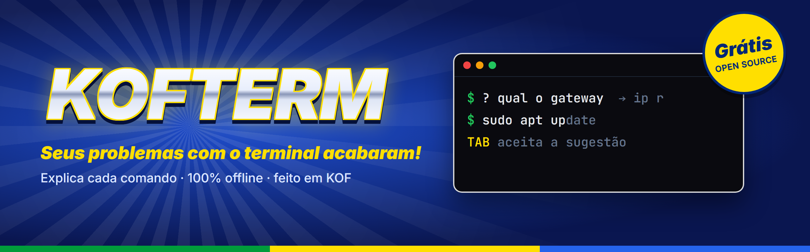

<p align="center">
  
</p>

<h1 align="center">KOFTERM</h1>

<p align="center"><b>O terminal Linux que te ensina enquanto você usa.</b><br>
Explica cada comando enquanto você digita, sugere o resto da linha e entende pedidos em português.<br>
Open source, 100% offline e escrito em <a href="https://koflang.github.io">KOF</a>, uma linguagem brasileira.</p>

<p align="center">
  <a href="LICENSE"></a>
  <a href="https://github.com/KofLang/Kof4j"></a>
  
  
  <a href="https://github.com/DATAdotPDF/kofterm/releases"></a>
  <a href="https://github.com/DATAdotPDF/kofterm/actions/workflows/ci.yml"></a>
  <a href="https://github.com/DATAdotPDF/kofterm/labels/good%20first%20issue"></a>
</p>

<p align="center">
  <a href="https://datadotpdf.github.io/kofterm/"><b>Site</b></a> ·
  <a href="README.md">English</a> ·
  <a href="CONTRIBUTING.md">Como contribuir</a> ·
  <a href="docs/COMO_FOI_FEITO.md">Como foi feito</a> ·
  <a href="docs/JOURNAL.md">Diário</a>
</p>

<p align="center">
  <b>O KofTerm é e sempre vai ser de graça.</b> Nenhuma função fica atrás de pagamento.<br>
  Mas se ele te ajudou e você sentir vontade de me pagar um cafézin (ou um Monster) pra eu virar<br>
  mais noites estudando e criando coisas legais pra comunidade, fico muito feliz &lt;3
</p>
<p align="center">
  <a href="https://www.buymeacoffee.com/dotpdf"></a><br>
  <sub>ou Pix (Itaú), chave aleatória: <code>a6a35680-c2cd-4e0e-ab3d-8c601cc159c4</code></sub>
</p>

---

```text
                                                                          │ Índice · F2 fecha · F1 busca
┌──(aluno㉿kali)-[~]                                                      │
└─$ sudo cat /etc/shadow                                                  │ cat
                                                                          │ Mostra o conteúdo de arquivos (ou
                                                                          │ junta vários).
                                                                          │
                                                                          │ TAMBÉM NA LINHA
                                                                          │ sudo
                                                                          │   "Super-user do": roda UM comando
                                                                          │   como administrador (root). Pede a
                                                                          │   SUA senha, não a do root, e só
                                                                          │   funciona se você estiver no grupo
                                                                          │   sudo. Tudo fica registrado no
                                                                          │   journal.
                                                                          │ /etc/shadow
                                                                          │   Os hashes das senhas e as regras
                                                                          │   de validade. Só o root lê: sem
                                                                          │   sudo dá "Permissão negada".
```
<p align="center"><sub>Tela real do KofTerm no Kali: à esquerda o seu Bash de sempre, à direita a coluna do índice explicando a linha (F2 mostra ou esconde).</sub></p>

## Instalar

Precisa de Linux x86_64 (uma VM serve). O programa depende só da `libc` do sistema.

**Release pronta, sem instalar o KOF:** baixe `kofterm-0.7.0-linux-x86_64.tar.gz` e `SHA256SUMS` da [página de releases](https://github.com/DATAdotPDF/kofterm/releases).

```bash
sha256sum -c SHA256SUMS --ignore-missing && tar -xzf kofterm-0.7.0-linux-x86_64.tar.gz && ./kofterm-0.7.0-linux-x86_64/kofterm install
```

**Pelo código:** o instalador compila com o KOF 0.6.6. Se o KOF faltar, ele pergunta antes de baixar e confere o SHA-256.

```bash
git clone https://github.com/DATAdotPDF/kofterm.git && cd kofterm && ./install.sh
```

Depois, é só abrir:

```bash
kofterm
```

## Primeiros passos

| Tecla | O que faz |
| --- | --- |
| **TAB** ou **→** | Aceita a sugestão em cinza (**Ctrl+→** aceita uma palavra) |
| **F2** | Mostra ou esconde a coluna do índice |
| **F1** ou **Ctrl+T** | Busca no índice em tela cheia |
| **?** + o seu pedido | `? instalar o htop`, `? quem usa a porta 22`. **TAB** coloca o comando na linha; Enter roda |
| **↑ / ↓** | Comandos anteriores |
| **Ctrl-L** | Limpa a tela e mantém o que você estava digitando |

Experimente nesta ordem: digite `ls -la` devagar e olhe a coluna; rode `cat /etc/shadow` e veja a linha seguinte; peça `? qual meu ip`. Para testar tudo com calma, siga o [roteiro de teste](docs/TESTE_HUMANO.md).

Outros comandos: `kofterm doctor` confere a instalação, `kofterm uninstall` remove o programa (o seu histórico fica; `--purge` apaga tudo).

## O que ele faz

| | |
| --- | --- |
| **Coluna do índice** | Enquanto você digita, a coluna à direita explica o comando, cada opção usada (`-ld` vira `-l` + `-d`), o `sudo` e os caminhos da linha (`/etc/shadow`). São 148 comandos e caminhos, escritos em português para quem está começando. **F1** abre a busca. |
| **Peça do seu jeito** | `? qual o gateway` sugere `ip r`; `? quanto espaço sobrou` sugere `df -h`. São 124 receitas revisadas por pessoas, com tolerância a acentos, sinônimos e erros de digitação. Ele nunca inventa comando. |
| **Sugestão em cinza** | O resto da linha aparece em cinza, como no VS Code, e o **TAB** aceita. Ele aprende com o que você roda, só na sua máquina. |
| **Lê o contexto** | "Permissão negada" sugere o mesmo comando com `sudo`; `gti status` vira `git status`; programa que falta vira `sudo apt install` com o pacote certo. |
| **Funciona como root** | Depois de `sudo -i`, tudo continua funcionando, e as sugestões saem sem `sudo`. |
| **Risco pelo contexto** | Olha todos os comandos da linha, o `sudo` (ou se você é root) e a pasta atual. **PERIGO** (`rm -rf /`, `> /etc/passwd`, `dd` num disco) fica vermelho e nunca é sugerido; **Atenção** (`sudo rm -rf /etc/nginx`, `curl … \| sh`, `reboot`) aparece em amarelo, sempre com o motivo. |

## Por que o KofTerm existe

Quem começa no Linux abre o terminal e encontra um cursor piscando. Para saber o que `ls -ld` faz é preciso garimpar o `--help`; para descobrir o comando de "ver o gateway" é preciso sair do terminal e pesquisar; um "Permissão negada" ou um "comando não encontrado" não diz o que fazer em seguida.

O KofTerm nasceu de quem estuda redes na Cisco e precisava aprender Bash numa VM Kali. Ele fica **ao lado do seu prompt** como um professor paciente: você continua no seu Bash de sempre, e ele explica, sugere e corrige enquanto você digita. Nada roda sem o seu Enter.

**É para você se:** está estudando Linux, redes ou cibersegurança (cursos da Cisco, laboratórios em VM, Codecademy, Hack The Box) e quer aprender o terminal usando o terminal.

## Seguro por regra

O KofTerm vê o que você digita, por isso segue regras que não mudam:

- **100% offline.** O programa não abre conexões de rede, e o CI recusa código de rede. Confira: dentro do KofTerm, `ls -l /proc/$PPID/fd | grep -c socket` mostra `0`.
- **Nada roda sozinho.** Sugestões e receitas só preenchem a linha.
- **Seus dados ficam com você,** em `~/.local/share/kofterm` (pasta 0700). Senhas do `sudo` não passam pelo editor; linhas com senha, token ou chave (e linhas começando com espaço) rodam, mas não são gravadas no histórico.
- **Estudo com ética.** Ferramentas de varredura e captura vêm com o aviso: só na sua rede de laboratório ou com autorização por escrito.
- **Não instala nada.** Quando falta uma ferramenta, ele explica como instalar; a decisão é sua.

Detalhes e como relatar uma falha: [SECURITY.md](SECURITY.md).

## Feito em KOF

O terminal, o emulador de tela, o modelo que aprende, o instalador e os 76 testes são escritos em [KOF](https://koflang.github.io), linguagem brasileira criada por Mel Santos. O que falta na linguagem vira uma biblioteca KOF paralela, nunca outra linguagem; a única fronteira é a libc do sistema. No caminho, quatro bugs do compilador foram encontrados e [reportados ao KOF](docs/KOF_FINDINGS.md). Memória estável em 7,9 MB.

Como tudo foi construído, fase por fase: [docs/COMO_FOI_FEITO.md](docs/COMO_FOI_FEITO.md).

## Como ajudar

O KofTerm é open source e feito para **ajudar, cooperar e somar**. Você **não precisa saber KOF**: as contribuições mais valiosas são texto em português simples.

| Quero... | Comece por |
| --- | --- |
| Ensinar um pedido novo ao modo `?` | [Receita nova](CONTRIBUTING.md#receita-nova-o-caminho-mais-rápido-para-o-seu-primeiro-pr) em `recipes/pt_BR.txt` |
| Explicar melhor um comando | [Entrada no índice](CONTRIBUTING.md#entrada-no-índice) em `index/pt_BR.txt` |
| Testar e contar o que achei | [Roteiro de teste](docs/TESTE_HUMANO.md) e uma [issue](https://github.com/DATAdotPDF/kofterm/issues/new/choose) |
| Programar em KOF | Issues [`good first issue`](https://github.com/DATAdotPDF/kofterm/labels/good%20first%20issue) e [`help wanted`](https://github.com/DATAdotPDF/kofterm/labels/help%20wanted) |
| Deixar o modelo mais esperto | `kofterm contribute --preview` mostra o que o seu modelo aprendeu, anonimizado; veja [datasets/contrib](datasets/contrib/README.md) |

Guia completo: [CONTRIBUTING.md](CONTRIBUTING.md) · [Código de Conduta](CODE_OF_CONDUCT.md)

## Próximos passos

| Versão | O que entra |
| --- | --- |
| **0.7.x** | Correções do teste da 0.7.0 e mais receitas de redes |
| **0.8.0**, achar coisas | Busca no histórico com Ctrl+R, lista de candidatos ao completar arquivos e a rodinha do mouse rolando a saída antiga |
| **0.9.0**, para todo mundo | Índice e receitas em inglês, emoji acima de U+FFFF e aviso claro quando o terminal for estreito demais |
| **1.0.0**, estável | Testado por outras pessoas em várias distribuições e terminais, sem limitação que atrapalhe, formatos de arquivo estáveis |
| **Depois** | Um modelo neural pequeno em KOF puro (`kof-nn`) que entende pedidos mais soltos, sempre apontando para receitas reais |

Como as versões são numeradas e os critérios da 1.0: [CONTRIBUTING, seção Versões](CONTRIBUTING.md#7-versões). Veja também o [CHANGELOG](CHANGELOG.md) e as [issues](https://github.com/DATAdotPDF/kofterm/issues).

**Limitações conhecidas:** a rodinha do mouse ainda não rola a saída antiga dentro do KofTerm; a coluna precisa que sobrem pelo menos 40 colunas para o Bash; emoji acima de U+FFFF aparecem como `�`.

## Contribuidores

Quem ajudou a construir o KofTerm, além do código: testes, receitas, explicações e ideias. Toda contribuição aceita entra aqui e no [CHANGELOG](CHANGELOG.md).

- **Pedro D. Ferreira** ([@DATAdotPDF](https://github.com/DATAdotPDF)): autor e primeiro testador humano.
- **Mariana** ([@marianabsctba](https://github.com/marianabsctba)): revisão técnica. Apontou a classificação de comandos perigosos pelo contexto, os testes de segurança do PTY e a proteção de segredos no histórico, que agora guiam a próxima versão de segurança.
- **Você?** Veja [como ajudar](CONTRIBUTING.md). 💙

## Como foi feito (processo e auditoria)

O KofTerm é desenvolvido em público, com cada decisão registrada:

- [docs/COMO_FOI_FEITO.md](docs/COMO_FOI_FEITO.md): fases, arquitetura, mapa do repositório e o processo de ponta a ponta.
- [docs/JOURNAL.md](docs/JOURNAL.md): o diário datado, incluindo os testes humanos e o que cada um mudou.
- [docs/KOF_FINDINGS.md](docs/KOF_FINDINGS.md): os achados sobre o compilador KOF, reportados ao repositório central.
- [CHANGELOG.md](CHANGELOG.md): o que mudou em cada versão.
- Commits e tags assinados; a assistência de IA (Claude Code) é declarada em cada commit.

## Créditos

- **Linguagem KOF:** criada por **Mel Santos** ([@melmonfre](https://github.com/melmonfre) · [LinkedIn](https://www.linkedin.com/in/aminadojava/)) e mantida com os contribuidores do KOF no repositório central **[KofLang/Kof4j](https://github.com/KofLang/Kof4j)**, sob GPL-3.0. Site: [koflang.github.io](https://koflang.github.io).
- **koffuster**, de [Luna (@lunalully)](https://github.com/lunalully/koffuster): referência de estrutura de uma ferramenta de terminal em KOF.
- **tldr-pages** ([tldr-pages/tldr](https://github.com/tldr-pages/tldr)), CC BY 4.0: exemplos de comandos para o índice e o corpus de treino.
- **SS64** ([ss64.com/bash](https://ss64.com/bash/)): referência de comandos. O conteúdo não é copiado para este repositório; o KofTerm usa links.

Avisos completos de terceiros em [NOTICE](NOTICE).

## Autoria

O KofTerm foi concebido e é desenvolvido por **Pedro D. Ferreira** ([@DATAdotPDF](https://github.com/DATAdotPDF)). A autoria está registrada no histórico do Git, no [diário de desenvolvimento](docs/JOURNAL.md) datado e em [AUTHORS.md](AUTHORS.md). A assistência de IA (Claude Code) é declarada com uma linha `Co-Authored-By` em cada commit em que ela ajudou.

Para citar o KofTerm, use o [CITATION.cff](CITATION.cff).

## Licença

GNU General Public License v3.0, a mesma licença do KOF. Veja [LICENSE](LICENSE).

## Contato

[](https://dotpdf.dev)
[](https://www.linkedin.com/in/data-pdf/)
[](https://github.com/DATAdotPDF)
[](mailto:data.pedutraferreira@gmail.com)

<p align="center">
  Do storytelling audiovisual a sistemas confiáveis de dados e segurança.
</p>
