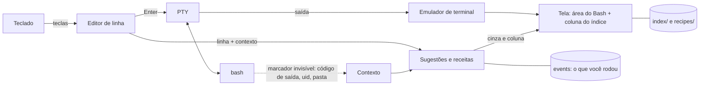

# Como o KofTerm foi feito

A parte técnica do projeto: fases, arquitetura, mapa do repositório e o processo de ponta a ponta. Para usar o KofTerm, comece pelo [README](../README.pt_BR.md); para contribuir, pelo [CONTRIBUTING.md](../CONTRIBUTING.md). O registro datado completo está no [diário](JOURNAL.md).

## Status atual

- **Fase 0 (spikes de FFI): concluída.** Modo raw do teclado, tamanho da janela e Bash rodando dentro de um pseudo-terminal estão provados em KOF native no Kali Linux. Veja [spikes/README.md](../spikes/README.md).
- **Fase 1 (terminal passthrough): concluída.** O `kofterm` roda o Bash num pseudo-terminal, repassa o código de saída do Bash, acompanha o redimensionamento da janela e restaura o seu terminal mesmo quando é morto por `SIGTERM` ou `SIGHUP`.
- **Fase 2 (editor de linha e ghost text): concluída.** No prompt, o KofTerm edita a linha e mostra em cinza o resto de um comando do seu histórico que combina com o que você digitou. **TAB** ou **→** aceita, **Ctrl+→** aceita uma palavra, e ↑/↓ navegam no histórico.
- **Fase 3 (índice offline e painel): concluída.** **F1** ou **Ctrl+T** abre uma aba em tela cheia com o índice e busca; **F2** divide a tela e mantém embaixo uma explicação ao vivo do que você está digitando. `ls -ld` mostra `-l` e `-d` explicados um a um, com exemplos e links de leitura.
- **Fase 4 (o modelo que entende contexto): concluída.** A sugestão em cinza agora vem de um modelo local que aprende com cada comando que você roda: usa o que você digitou, o comando anterior, o tipo de pasta em que você está e quão recente é cada comando. Na linha vazia ele prevê o próximo comando, oferece `sudo` depois de "Permissão negada" e corrige o nome depois de "comando não encontrado". Também completa arquivos, pastas e opções, e nunca sugere comandos perigosos.
- **Fase 5 (contribuição, instalador, primeira release): concluída.** `kofterm contribute` exporta o que o seu modelo aprendeu, anonimizado na sua máquina, para você revisar e enviar por pull request; o CI valida cada contribuição e a próxima versão aprende com ela. Instalação com um comando, pela release ou pelo código. **Primeira release: v0.5.0.**
- **Fase 6 (o KofTerm desenha a própria tela): concluída.** Um emulador de terminal escrito em KOF (`vt.kf`) interpreta tudo o que o Bash e os programas escrevem, então o índice fica numa **coluna à direita** que os programas nunca tocam: o Bash, o `vim`, o `top` e o `less` enxergam só a área da esquerda. Funciona dentro de qualquer terminal Linux.
- **Fase 7 (modo humanizado): concluída.** Digite `?` e o que você quer fazer, do seu jeito. O KofTerm acha a mais parecida entre 124 receitas escritas por pessoas (357 jeitos de pedir), preenche as lacunas e mostra o comando em cinza; o TAB coloca na linha, nada roda sozinho, e a coluna lateral explica cada parte.
- **Próximos passos:** o seu retorno como primeiro testador humano, mais receitas e entradas no índice, índice em inglês, lista de candidatos ao completar arquivos, modelo neural opcional em KOF puro (`kof-nn`).

## Funcionalidades

| Funcionalidade | Status |
| --- | --- |
| Bash dentro de um pseudo-terminal (cores, Ctrl-C, redimensionar, código de saída) | ✅ Fase 1 |
| Terminal restaurado mesmo se o KofTerm for morto (`SIGTERM`, `SIGHUP`) | ✅ Fase 1 |
| Sugestão em ghost text, **TAB** / **→** aceita a linha, **Ctrl+→** aceita uma palavra | ✅ Fase 2 |
| Edição de linha: ←/→, Home/End, Ctrl-A/E/U/K/W, Ctrl-L, histórico com ↑/↓, UTF-8 (acentos) | ✅ Fase 2 |
| Histórico privado em `~/.local/share/kofterm` (pasta 0700, arquivos 0600) | ✅ Fase 2 |
| Sugestões com contexto (o que você digitou, comando anterior, código de saída, tipo de pasta) | ✅ Fase 4 |
| Linha vazia prevê o próximo comando (`sudo apt update` → `sudo apt upgrade`) | ✅ Fase 4 |
| Aprende com você conforme você roda comandos, localmente, desde a primeira repetição | ✅ Fase 4 |
| Correções depois de erros: `sudo` após "Permissão negada", nome certo após "comando não encontrado" | ✅ Fase 4 |
| Completa arquivos, pastas (`/etc/hostn` → `ame`) e opções (`ls --a` → `ll`) | ✅ Fase 4 |
| Comandos perigosos (`rm -rf /`, `mkfs`, `dd of=/dev/sd…`, fork bomb) em vermelho e nunca sugeridos | ✅ Fase 4 |
| Aba do índice em tela cheia com busca (**F1** / **Ctrl+T**), 148 entradas em português (comandos, redes, usuários, serviços e caminhos importantes) | ✅ Fase 3 |
| **Coluna do índice à direita** com explicação ao vivo da linha atual (**F2**, lembrado) | ✅ Fase 6 |
| Emulador de terminal próprio: o Bash e os programas de tela cheia nunca escrevem por cima do índice | ✅ Fase 6 |
| Modo humanizado: `? o que você quer` → comando real de 124 receitas revisadas | ✅ Fase 7 |
| Cada opção explicada separadamente (`-ld` → `-l` + `-d`), com exemplos e links de leitura | ✅ Fase 3 |
| Contribuição opcional e anonimizada do aprendizado de volta ao projeto via Git | ✅ Fase 5 |
| Modelo neural pequeno opcional, treinado e executado em KOF puro (`kof-nn`) | Fase 8 (planejada) |
| Instalação com um comando, pela release ou pelo código; `doctor` e `uninstall` | ✅ Fase 5 |

## Como funciona



O KofTerm controla a linha que você está editando, como o fish shell. Quando você aperta Enter, a linha vai para um Bash de verdade rodando num pseudo-terminal, e a saída do Bash volta para o seu terminal. Sugestões são só texto: nada roda antes do Enter.

## Mapa do repositório

```text
kofterm/
├── docs/
│   ├── PLAN.md              Plano completo: arquitetura, módulos, IA, índice, fases
│   ├── JOURNAL.md           Diário de desenvolvimento datado (registro de autoria)
│   ├── TESTE_HUMANO.md      Roteiro de teste para uma pessoa de verdade
│   ├── divulgacao/          Roteiro do vídeo e texto de divulgação
│   └── images/              Banner e capturas de tela
├── .github/workflows/ci.yml Testes, build nativo, checagem de "sem rede", validação das contribuições
├── corpus/
│   ├── sessions.txt         Sequências iniciais de comandos, para as sugestões funcionarem no primeiro dia
│   └── commands.txt         Lista pública de nomes de comandos (só eles passam pelo anonimizador)
├── datasets/contrib/        Contribuições anonimizadas da comunidade (.kofdata)
├── recipes/
│   └── pt_BR.txt            Receitas do modo humanizado: jeitos de pedir → comando (veja abaixo)
├── index/
│   └── pt_BR.txt            O índice offline de comandos, escrito pelo projeto (veja abaixo)
├── spikes/                  Fase 0: uma pasta por prova, cada uma com main.kf
│   ├── 01_raw_keys/         Modo raw, leitura do teclado byte a byte
│   ├── 02_winsize/          Tamanho da janela via ioctl(TIOCGWINSZ)
│   └── 03_pty_bash/         Bash dentro de um PTY com forkpty + ppoll
├── src/                     O terminal em si, todo em .kf
│   ├── main.kf              Laço de eventos: teclado, saída do Bash e sinais
│   ├── session.kf           No prompt: edição da linha, ghost text, envio ao Bash
│   ├── keys.kf              Bytes crus → teclas, com testes (futura kof-ansi)
│   ├── editor.kf            A linha sendo digitada e o cursor, com testes
│   ├── history.kf           Histórico e sugestões, com testes
│   ├── prompt.kf            Acha o marcador invisível de prompt na saída do Bash, com testes
│   ├── vt.kf                Emulador de terminal (subconjunto do xterm), com testes (futura kof-ansi)
│   ├── recipes.kf           Modo humanizado: liga o pedido a uma receita, com testes
│   ├── index.kf             Formato do índice, busca e separação de opções (-ld → -l, -d), com testes
│   ├── model.kf             O modelo que aprende, regras de segurança, correção de typo, mapa próprio, com testes
│   ├── brain.kf             Liga o modelo à pasta, aos arquivos, às opções e aos seus eventos
│   ├── anon.kf              Anonimizador e validador das contribuições, com testes
│   ├── cli.kf               Subcomandos: contribute, check, install, uninstall, doctor
│   ├── tab.kf               A aba do índice em tela cheia (F1 / Ctrl+T)
│   ├── storage.kf           Arquivos privados, conversões UTF-8, o bashrc do KofTerm
│   ├── 00_libc.kf           Todos os extern da libc e constantes do Linux; nome para compilar primeiro (veja o diário)
│   ├── tty.kf               Modo raw, restauração, tamanho da janela (futura kof-tty)
│   ├── pty.kf               Bash num pseudo-terminal, código de saída (futura kof-tty)
│   └── sig.kf               Sinais lidos como dados via signalfd (futura kof-tty)
├── site/                    O site do projeto (HTML e CSS estáticos) e a capa
├── .github/                 CI, publicação do site, modelos de issue e de pull request
├── AUTHORS.md               Autor e créditos
├── CHANGELOG.md             Mudanças por versão
├── CONTRIBUTING.md          Como contribuir: do primeiro PR ao código em KOF
├── CODE_OF_CONDUCT.md       Código de conduta
├── SECURITY.md              Política de segurança e como relatar falhas
├── CITATION.cff             Como citar o projeto
├── LICENSE                  GNU GPL v3
├── NOTICE                   Créditos e licenças de terceiros
└── install.sh               Bootstrap: obtém o KOF se faltar (SHA-256 fixo), compila, roda kofterm install
```

## Roadmap

| Fase | Objetivo | Status |
| --- | --- | --- |
| 0 | Spikes de FFI: modo raw, tamanho da janela, PTY | ✅ concluída (21/10/2026) |
| 1 | Terminal passthrough, restauração segura em sinais (`signalfd`) | ✅ concluída (21/10/2026) |
| 2 | Editor de linha e ghost text a partir do histórico | ✅ concluída (21/10/2026) |
| 3 | Índice offline, aba do índice, painel ao vivo, explicação por opção, links de leitura | ✅ concluída (21/10/2026) |
| 4 | Modelo n-gram com aprendizado contínuo local, contexto, gramática, regras de segurança | ✅ concluída (21/10/2026) |
| 5 | `kofterm contribute` (anonimizado, opcional), instalador, CI com checagem de "sem rede", primeira release | ✅ concluída (21/10/2026), v0.5.0 |
| 6 | Emulador de terminal próprio, coluna do índice à direita | ✅ concluída (21/10/2026) |
| 7 | Modo humanizado com receitas | ✅ concluída (21/10/2026), v0.6.0 |
| 8 | Modelo neural opcional em KOF puro (`kof-nn`) que entende pedidos mais soltos, sempre apontando para receitas reais | planejada |

Bibliotecas KOF paralelas que serão extraídas no caminho: `kof-tty` (terminal e PTY), `kof-ansi` (teclas e tela), `kof-nn` (tensores e um transformer pequeno).

## Processo de ponta a ponta

**1. Ideia.** O VS Code com o Gemini sugere o resto da linha e o TAB aceita. Eu queria o mesmo no terminal Linux, mas local, privado e restrito a comandos Linux, com uma cola sempre a uma tecla de distância.

**2. Pesquisa.** Estudei o site da linguagem KOF, a biblioteca padrão e os targets, o corpus `training/` do [repositório central do KOF](https://github.com/KofLang/Kof4j) e o [koffuster](https://github.com/lunalully/koffuster), uma ferramenta de terminal escrita em KOF, como referência de estrutura.

**3. Decisões de escopo.** Um emulador de terminal gráfico completo estava fora do escopo de um primeiro projeto, então o KofTerm é um front-end que roda dentro de qualquer terminal existente. Target: KOF native, o mais próximo de um binário Linux comum. IA: primeiro um modelo n-gram, depois um modelo neural opcional. Documentação: tldr-pages e `man` local, com o SS64 apenas como links, porque o conteúdo dele tem copyright.

**4. A regra "só KOF".** O primeiro plano usava Python no treino e um helper em C como alternativa. Eu recusei: KOF é o coração do projeto, e o que faltar vira uma biblioteca KOF paralela. Assim o ciclo inteiro fica auditável e dentro de uma só linguagem.

**5. Máquina de testes.** O KOF 0.6.6 foi instalado numa VM Kali Linux a partir da release oficial, com o SHA-256 conferido. A VM é acessada por SSH com uma chave dedicada.

**6. Achados da Fase 0.** Os três spikes passaram depois de corrigir o que a documentação não dizia. O KOF não tem constantes no nível do arquivo (elas ficam como campos `static` numa classe). `Buffer(U8)` não pode ser parâmetro de função, então a memória é tratada como ponteiros `Long` crus vindos de `malloc`. Um `extern` chamado `poll` é desviado em silêncio para o `poll` de concorrência do próprio KOF, então o terminal usa `ppoll`. Detalhes em [spikes/README.md](../spikes/README.md).

**7. Fase 1: um terminal de verdade.** O spike virou o `src/`, dividido em módulos que depois formarão a biblioteca `kof-tty`. Os sinais são bloqueados e lidos como dados por um `signalfd` no mesmo laço do `ppoll`, porque o KOF não consegue guardar um callback de sinal. Isso dá redimensionamento no `SIGWINCH` e terminal restaurado no `SIGTERM` e no `SIGHUP`. Verificado no Kali: o código de saída do Bash é repassado (`exit 7` → 7) e nenhum Bash órfão fica para trás.

**8. Fase 2: o KofTerm é dono da linha.** O Bash inicia sem o próprio editor de linha (`--noediting`), e o bashrc do KofTerm carrega o seu e acrescenta um marcador invisível no fim do prompt, com o último código de saída e a pasta atual. Quando o marcador chega, o KofTerm edita a linha, desenha a sugestão em cinza e só envia a linha pronta no Enter; enquanto um comando roda, cada tecla vai direto para ele. Mais duas armadilhas do KOF apareceram: `charAt` devolve um caractere, não uma `String`, e uma função escrita por você (`writeFile`) pode ser trocada em silêncio por uma função nativa do KOF com o mesmo nome. Agora 19 testes unitários cobrem os módulos puros.

**9. Fase 3: o índice.** 53 entradas escritas pelo projeto em português para quem está aprendendo Bash, do `ls` ao `git commit` e aos operadores do shell (`|`, `>`, `&&`…), com todos os links de leitura conferidos. A aba usa a tela alternativa do terminal, então o Esc devolve exatamente o que estava antes. O painel ao vivo divide a tela com uma região de rolagem e avisa ao Bash que a tela dele ficou menor; agora o KofTerm pergunta ao terminal onde está o cursor a cada prompt e desenha por posição absoluta, o que também corrigiu as linhas longas no fim da tela. Um painel à direita exigiria que o KofTerm emulasse um terminal inteiro, então a divisão é em cima/embaixo por enquanto.

**10. Fase 4: o modelo.** Um modelo de contagens escrito em KOF aprende com cada comando quando o código de saída volta: quantas vezes cada linha é usada, qual linha costuma vir depois de qual, em que tipo de pasta (`git`, `node`, `python`…, nunca o nome da pasta) e qual palavra costuma vir depois de outras duas. Erros de digitação (código 127) nunca viram sugestão. Um corpus inicial escrito pelo projeto dá sugestões razoáveis desde o primeiro dia. Três obstáculos novos: o `Map` nativo do KOF cai por volta de 3.650 chaves (o projeto agora tem um mapa próprio em KOF), um `extern` declarado num arquivo compilado depois passa strings erradas para o C (o arquivo de declarações agora é `00_libc.kf`), e o bashrc do Kali reescreve o `PROMPT_COMMAND` no primeiro prompt (o gancho do KofTerm agora se reinstala). Todos os achados sobre o KOF estão em [docs/KOF_FINDINGS.md](KOF_FINDINGS.md), para os mantenedores do KOF.

**11. Fase 5: o aprendizado que volta, e a primeira release.** `kofterm contribute` transforma o seu arquivo de eventos em padrões agregados e anonimizados: só passam como estão nomes de comandos de uma lista pública, opções e operadores do shell; caminhos, arquivos, hosts, IPs, usuários, números e textos entre aspas viram marcadores; um programa desconhecido vira `<CMD>`; e qualquer linha com cara de segredo é descartada inteira. Só ficam padrões vistos pelo menos 3 vezes, sem datas nem ordem da sessão. Testado com um histórico falso cheio de nomes de cliente, domínio interno, IP privado, token do GitHub, senha do MySQL e cabeçalho Bearer: nada disso sobreviveu. As mesmas regras validam cada `.kofdata` no CI, e o KofTerm carrega `datasets/contrib/` ao iniciar, então cada versão aprende com a comunidade. O instalador é um bootstrap curto em Bash; todo o resto (`install`, `uninstall`, `doctor`) é o próprio KofTerm, em KOF.

**12. Fase 6: o KofTerm desenha a própria tela.** O primeiro teste humano deixou uma coisa clara: um índice que empurra o terminal atrapalha. Então o KofTerm passou a funcionar como o `tmux`: um emulador de terminal escrito em KOF a partir do comportamento público do xterm/ECMA-48 (texto, UTF-8, cores até RGB, regiões de rolagem, tela alternativa, desenho de linhas) guarda a tela na memória, e o KofTerm a desenha com o índice numa coluna à direita. O Bash e todos os programas recebem uma janela mais estreita e nunca tocam a coluna. A primeira versão vazava memória com o `top` aberto (8 → 35 MB em um minuto), porque o coletor do KOF 0.6.6 native recupera só parte das Strings temporárias; agora o desenho vai direto para um buffer em C com `stpcpy`, o interpretador lê números em vez de montar Strings e as linhas são reaproveitadas ao rolar: o uso de CPU caiu cerca de 18 vezes e o crescimento virou um fio.

**13. Fase 7: modo humanizado.** `? instalar o htop` procura entre 63 receitas escritas por pessoas (164 jeitos de pedir), tolera acentos e uma letra errada, e preenche as lacunas com as palavras do pedido. É recuperação, não geração: o KofTerm nunca inventa comando, as palavras do pedido nunca levam caracteres do shell para o comando, resultados perigosos são descartados e o comando só roda depois que a pessoa lê e aperta Enter de novo.

**14. Root e estudos de redes (0.6.2).** O terceiro teste humano mostrou que o índice não dizia o que o `sudo` faz e que o KofTerm parava de funcionar depois do `sudo -i`, porque o shell de root não carregava o gancho dele. Agora a coluna explica cada parte da linha, inclusive o prefixo `sudo` e caminhos como `/etc/shadow`, e `sudo -i`, `sudo -s`, `sudo su` e um `bash` simples abrem o shell de dentro já com o gancho do KofTerm. O índice passou a 148 entradas e as receitas a 122, pensadas para quem estuda Linux, redes e segurança no próprio laboratório: rotas, DNS, portas, captura de pacotes, firewall, chaves SSH, usuários, logs, hashes e os caminhos importantes do sistema, tudo conferido numa VM Kali.

**15. O que falta, o KofTerm aponta (0.6.3 e 0.6.4).** Como root, as receitas tiram o `sudo` e param de oferecer `sudo -i`. Quando um programa não está instalado, a coluna avisa enquanto você digita e mostra "para baixar o que falta, use » `sudo apt install x`"; depois de "comando não encontrado", a linha vazia já traz esse comando. O pacote vem do índice ou do que o próprio sistema disse, e um erro de uma letra de um comando conhecido (`gti`, `sl`) continua sendo corrigido em vez de instalar um pacote de brincadeira. O KofTerm nunca instala nada sozinho: o que falta dentro do KOF vira projeto paralelo em KOF, e as ferramentas do sistema são instaladas pela pessoa, com o KofTerm explicando como.

O registro completo e datado está em [docs/JOURNAL.md](JOURNAL.md); os achados sobre o KOF estão em [docs/KOF_FINDINGS.md](KOF_FINDINGS.md).

## Para quem desenvolve

**Para quem desenvolve.** Compile e rode a partir do repositório sem instalar, e rode os testes unitários (76 testes, um arquivo por vez):

```bash
kof build src --target native --output build/kofterm && ./build/kofterm/Default/Main
```
```bash
for f in keys editor history prompt index model anon vt recipes; do kof test src/$f.kf --target native; done
```

Opcional, os spikes da Fase 0 (numa janela de terminal de verdade, não por pipe):

```bash
cd spikes/02_winsize && kof run main.kf --target=native
```
```bash
cd ../01_raw_keys && kof run main.kf --target=native
```
```bash
cd ../03_pty_bash && kof run main.kf --target=native
```

O spike 01 mostra cada tecla que você aperta (`q` sai). O spike 03 abre um Bash dentro do pseudo-terminal do KofTerm; digite `exit` para voltar. Se o terminal ficar estranho, `reset` resolve.
