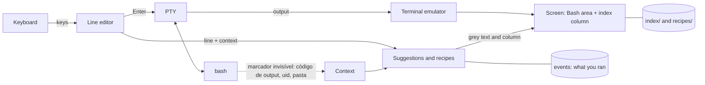

# How KofTerm was built

The technical side of the project: phases, architecture, repository map and the end-to-end process. To use KofTerm, start with the [README](../README.md); to contribute, with [CONTRIBUTING.md](../CONTRIBUTING.md). The full dated log is in the [journal](JOURNAL.md).

## Current status

- **Phase 0 (FFI spikes): done.** Raw keyboard mode, window size and Bash running inside a pseudo-terminal are proven in KOF native on Kali Linux. See [spikes/README.md](../spikes/README.md).
- **Phase 1 (passthrough terminal): done.** `kofterm` runs Bash in a pseudo-terminal, passes Bash's exit code through, follows window resizes and restores your terminal even when killed by `SIGTERM` or `SIGHUP`.
- **Phase 2 (line editor and ghost text): done.** At the prompt, KofTerm edits the line itself and shows the rest of a matching command from your history in grey. **TAB** or **→** accepts it, **Ctrl+→** accepts one word, and ↑/↓ browse the history.
- **Phase 3 (offline command index and panel): done.** **F1** or **Ctrl+T** opens a full-screen index tab with search; **F2** splits the screen and keeps a live explanation of what you are typing at the bottom. `ls -ld` shows `-l` and `-d` explained one by one, with examples and reading links.
- **Phase 4 (the context-aware model): done.** The grey suggestion now comes from a local model that learns from every command you run: it uses what you typed, the previous command, the kind of folder you are in and how recent each command is. On an empty line it predicts your next command, offers `sudo` after "Permission denied" and fixes typos after "command not found". It also completes files, folders and options, and never suggests dangerous commands.
- **Phase 5 (contribution, installer, first release): done.** `kofterm contribute` exports what your model learned, anonymized on your machine, for you to review and send by pull request; CI validates every contribution and the next release learns from it. One-command install from the release or from the source. **First release: v0.5.0.**
- **Phase 6 (KofTerm draws its own screen): done.** A terminal emulator written in KOF (`vt.kf`) interprets everything Bash and programs write, so the index lives in a **column on the right** that programs never touch: Bash, `vim`, `top` and `less` see only the left area. Works inside any Linux terminal.
- **Phase 7 (human mode): done.** Type `?` and what you want to do, in your own words. KofTerm finds the closest of 124 recipes (357 ways of asking) written by people, fills in the gaps and shows the command in grey; TAB puts it on the line, nothing runs by itself, and the side column explains each part.
- **Next:** your feedback as the first human tester, more recipes and index entries, an English index, candidate list for file completion, optional neural model in pure KOF (`kof-nn`).

## Features

| Feature | Status |
| --- | --- |
| Runs Bash inside a pseudo-terminal (colors, Ctrl-C, resize, exit code) | ✅ Phase 1 |
| Terminal restored even if KofTerm is killed (`SIGTERM`, `SIGHUP`) | ✅ Phase 1 |
| Ghost-text suggestion, **TAB** / **→** accepts the line, **Ctrl+→** accepts one word | ✅ Phase 2 |
| Line editing: ←/→, Home/End, Ctrl-A/E/U/K/W, Ctrl-L, ↑/↓ history, UTF-8 (accents) | ✅ Phase 2 |
| Private history in `~/.local/share/kofterm` (folder 0700, files 0600) | ✅ Phase 2 |
| Context-aware suggestions (what you typed, previous command, exit code, kind of folder) | ✅ Phase 4 |
| Empty line predicts your next command (`sudo apt update` → `sudo apt upgrade`) | ✅ Phase 4 |
| Learns from you as you run commands, locally, from the first repetition | ✅ Phase 4 |
| Fixes after errors: `sudo` after "Permission denied", typo after "command not found" | ✅ Phase 4 |
| Completes files, folders (`/etc/hostn` → `ame`) and options (`ls --a` → `ll`) | ✅ Phase 4 |
| Dangerous commands (`rm -rf /`, `mkfs`, `dd of=/dev/sd…`, fork bomb) in red and never suggested | ✅ Phase 4 |
| Full-screen index tab with search (**F1** / **Ctrl+T**), 148 entries in Portuguese (commands, networking, users, services and important paths) | ✅ Phase 3 |
| Index **column on the right** with a live explanation of the current line (**F2**, remembered) | ✅ Phase 6 |
| Own terminal emulator: Bash and full-screen programs never write over the index | ✅ Phase 6 |
| Human mode: `? what you want` → a real command from 124 reviewed recipes | ✅ Phase 7 |
| Each option explained on its own (`-ld` → `-l` + `-d`), with examples and reading links | ✅ Phase 3 |
| Opt-in, anonymized contribution of your learning back to the project via Git | ✅ Phase 5 |
| Optional tiny neural model, trained and run in pure KOF (`kof-nn`) | Phase 8 (planned) |
| One-command install from the release or the source; `doctor` and `uninstall` | ✅ Phase 5 |

## How it works



KofTerm owns the line you are editing, like the fish shell. When you press Enter, the line is sent to a real Bash running in a pseudo-terminal, and Bash's output is relayed back to your terminal. Suggestions are only text: nothing runs until you press Enter.

## Repository map

```text
kofterm/
├── docs/
│   ├── PLAN.md              Full plan: architecture, modules, AI, index, phases
│   ├── JOURNAL.md           Dated development journal (authorship record)
│   └── images/              Banner and screenshots
├── .github/workflows/ci.yml Tests, native build, "no network" check, contribution validation
├── corpus/
│   ├── sessions.txt         Starter sequences of commands, so suggestions work on day one
│   └── commands.txt         Public list of command names (the anonymizer keeps only these)
├── datasets/contrib/        Anonymized contributions from the community (.kofdata)
├── recipes/
│   └── pt_BR.txt            Human-mode recipes: ways to ask → command (see below)
├── index/
│   └── pt_BR.txt            The offline command index, written by the project (see below)
├── spikes/                  Phase 0: one folder per proof, each with main.kf
│   ├── 01_raw_keys/         Raw mode, byte-by-byte keyboard input
│   ├── 02_winsize/          Window size via ioctl(TIOCGWINSZ)
│   └── 03_pty_bash/         Bash inside a PTY with forkpty + ppoll
├── src/                     The terminal itself, all .kf
│   ├── main.kf              Event loop: keyboard, Bash output and signals
│   ├── session.kf           At the prompt: line editing, ghost text, sending to Bash
│   ├── keys.kf              Raw bytes → keys, with tests (future kof-ansi)
│   ├── editor.kf            The line being typed and its cursor, with tests
│   ├── history.kf           History and suggestions, with tests
│   ├── prompt.kf            Finds the invisible prompt marker in Bash's output, with tests
│   ├── vt.kf                Terminal emulator (xterm subset), with tests (future kof-ansi)
│   ├── recipes.kf           Human mode: matches what you ask to a recipe, with tests
│   ├── index.kf             Index format, search and option splitting (-ld → -l, -d), with tests
│   ├── model.kf             The learning model, safety rules, typo fix, own hash map, with tests
│   ├── brain.kf             Connects the model to the folder, files, options and your events
│   ├── anon.kf              Anonymizer and validator for contributions, with tests
│   ├── cli.kf               Subcommands: contribute, check, install, uninstall, doctor
│   ├── tab.kf               The full-screen index tab (F1 / Ctrl+T)
│   ├── storage.kf           Private files, UTF-8 conversions, KofTerm's bashrc
│   ├── 00_libc.kf           Every libc extern and Linux constant; named to compile first (see journal)
│   ├── tty.kf               Raw mode, restore, window size (future kof-tty)
│   ├── pty.kf               Bash in a pseudo-terminal, exit status (future kof-tty)
│   └── sig.kf               Signals read as data through signalfd (future kof-tty)
├── site/                    Project website (static HTML and CSS) and cover image
├── .github/                 CI, site publishing, issue and pull request templates
├── AUTHORS.md               Author and credits
├── CHANGELOG.md             Versioned changes
├── CONTRIBUTING.md          How to contribute: from a first PR to KOF code
├── CODE_OF_CONDUCT.md       Code of conduct
├── SECURITY.md              Security policy and how to report issues
├── CITATION.cff             How to cite this project
├── LICENSE                  GNU GPL v3
├── NOTICE                   Third-party credits and licenses
└── install.sh               Bootstrap: gets KOF if missing (SHA-256 pinned), builds, runs kofterm install
```

## Roadmap

| Phase | Goal | Status |
| --- | --- | --- |
| 0 | FFI spikes: raw mode, window size, PTY | ✅ done (21/10/2026) |
| 1 | Passthrough terminal, signal-safe restore (`signalfd`) | ✅ done (21/10/2026) |
| 2 | Line editor and ghost text from history | ✅ done (21/10/2026) |
| 3 | Offline command index, index tab, live panel, per-option explanations, reading links | ✅ done (21/10/2026) |
| 4 | n-gram model with local continuous learning, context, grammar, safety rules | ✅ done (21/10/2026) |
| 5 | `kofterm contribute` (anonymized, opt-in), installer, CI with "no network" check, first release | ✅ done (21/10/2026), v0.5.0 |
| 6 | Own terminal emulator, index column on the right | ✅ done (21/10/2026) |
| 7 | Human mode with recipes | ✅ done (21/10/2026), v0.6.0 |
| 8 | Optional neural model in pure KOF (`kof-nn`) that understands looser requests, always pointing to real recipes | planned |

Parallel KOF libraries that will be extracted along the way: `kof-tty` (terminal and PTY), `kof-ansi` (keys and screen), `kof-nn` (tensors and a tiny transformer).

## End-to-end process

**1. Idea.** VS Code with Gemini suggests the rest of a line and TAB accepts it. I wanted the same in the Linux terminal, but local, private and limited to Linux commands, with a cheat sheet always one keystroke away.

**2. Research.** I studied the KOF language site, its standard library and targets, the `training/` corpus of the [KOF central repository](https://github.com/KofLang/Kof4j), and [koffuster](https://github.com/lunalully/koffuster), a terminal tool written in KOF, as a reference for project layout.

**3. Scope decisions.** A full graphical terminal emulator was out of scope for a first project, so KofTerm is a terminal front-end that runs inside any existing terminal. Target: KOF native, the closest thing to a regular Linux binary. AI: an n-gram model first, an optional neural model later. Documentation: tldr-pages and local `man` pages, with SS64 kept as links only because its content is copyrighted.

**4. The KOF-only rule.** The first plan used Python for training and a C helper as a fallback. I rejected that: KOF is the heart of the project, and anything missing becomes a parallel KOF library. That keeps the whole loop auditable and inside one language.

**5. Test machine.** KOF 0.6.6 was installed on a Kali Linux VM from the official release, with the SHA-256 checked. The VM is reached over SSH with a dedicated key.

**6. Phase 0 findings.** All three spikes passed after fixing what the docs did not say. KOF has no file-level constants (they live as `static` fields in a class). `Buffer(U8)` cannot be a function parameter, so memory is handled as raw `Long` pointers from `malloc`. An `extern` named `poll` is silently routed to KOF's own concurrency `poll`, so the terminal uses `ppoll`. Details in [spikes/README.md](../spikes/README.md).

**7. Phase 1: a real terminal.** The spike became `src/`, split into modules that will later form the `kof-tty` library. Signals are blocked and read as data through `signalfd` in the same `ppoll` loop, because KOF cannot keep a signal callback. That gives resize on `SIGWINCH` and a restored terminal on `SIGTERM` and `SIGHUP`. Verified on Kali: Bash's exit code passes through (`exit 7` → 7), and no orphan Bash is left behind.

**8. Phase 2: KofTerm owns the line.** Bash starts without its own line editor (`--noediting`), and KofTerm's bashrc loads yours and adds an invisible marker at the end of the prompt with the last exit code and the current folder. When the marker arrives, KofTerm edits the line, draws the grey suggestion and only sends the finished line on Enter; while a command runs, every key goes straight to it. Two more KOF traps showed up: `charAt` returns a character, not a `String`, and a function you write yourself (`writeFile`) can be silently replaced by a KOF built-in of the same name. 19 unit tests now cover the pure modules.

**9. Phase 3: the index.** 53 entries written by the project in Portuguese for people learning Bash, from `ls` to `git commit` and the shell operators (`|`, `>`, `&&`…), with every reading link checked. The tab uses the terminal's alternate screen, so Esc brings back exactly what was there. The live panel splits the screen with a scroll region and tells Bash its screen is shorter; KofTerm now asks the terminal where the cursor is at each prompt and draws by absolute position, which also fixed long lines at the bottom of the screen. A right-hand side panel would need KofTerm to emulate a whole terminal, so the split is top/bottom for now.

**10. Phase 4: the model.** A counting model written in KOF learns from every command when its exit code comes back: how often each line is used, which line usually follows which, in what kind of folder (`git`, `node`, `python`…, never the folder name) and which word usually follows two others. Typos (exit 127) never become suggestions. A starter corpus written by the project gives sensible suggestions on day one. Three new obstacles: KOF's native `Map` crashes at about 3,650 keys (the project now has its own hash map in KOF), an `extern` declared in a file compiled later passes strings wrongly to C (the declarations file is now `00_libc.kf`), and Kali's bashrc rewrites `PROMPT_COMMAND` on the first prompt (KofTerm's hook now reinstalls itself). All KOF findings are written up in [docs/KOF_FINDINGS.md](KOF_FINDINGS.md) for the KOF maintainers.

**11. Phase 5: learning that comes back, and the first release.** `kofterm contribute` turns your event file into aggregated, anonymized patterns: only command names from a public list, options and shell operators pass as they are; paths, files, hosts, IPs, users, numbers and quoted text become placeholders; an unknown program name becomes `<CMD>`; and any line that looks like a secret is dropped whole. Only patterns seen at least 3 times are kept, with no dates or session order. Tested against a fake history full of client names, an internal domain, a private IP, a GitHub token, a MySQL password and a Bearer header: none of it survived. The same rules validate every `.kofdata` in CI, and KofTerm loads `datasets/contrib/` at startup, so each release learns from the community. The installer is a short Bash bootstrap; everything else (`install`, `uninstall`, `doctor`) is KofTerm itself, in KOF.

**12. Phase 6: KofTerm draws its own screen.** The first human test made one thing clear: an index that pushes the terminal around gets in the way. So KofTerm now works like `tmux`: a terminal emulator written in KOF from the public xterm/ECMA-48 behavior (text, UTF-8, colors up to RGB, scroll regions, alternate screen, line drawing) keeps the screen in memory, and KofTerm draws it with the index in a column on the right. Bash and every program get a narrower window and never touch the column. The first version leaked memory with `top` running (8 → 35 MB in a minute) because KOF 0.6.6's native collector reclaims only part of temporary strings; drawing now goes straight into a C buffer with `stpcpy`, the parser reads numbers instead of building strings, and rows are reused on scroll: CPU fell about 18 times and the growth to a slow trickle.

**13. Phase 7: human mode.** `? instalar o htop` searches 63 recipes written by people (164 ways of asking), tolerant to accents and one-letter typos, and fills the gaps with the words of the request. It is retrieval, not generation: KofTerm never invents a command, words from the request never carry shell characters into it, dangerous results are dropped, and the command only runs after the person reads it and presses Enter again.

**14. Root and network studies (0.6.2).** The third human test found that the index did not say what `sudo` does, and that KofTerm stopped working after `sudo -i`, because the root shell did not load its hook. Now the column explains every part of the line, including the `sudo` prefix and file paths such as `/etc/shadow`, and `sudo -i`, `sudo -s`, `sudo su` and a plain `bash` open the inner shell with KofTerm's hook. The index grew to 148 entries and the recipes to 122, aimed at people studying Linux, networking and security in their own labs: routes, DNS, ports, packet capture, firewall, SSH keys, users, logs, hashes and the important paths of the system, all checked against a Kali VM.

**15. What is missing, KofTerm points to (0.6.3 and 0.6.4).** As root, recipes drop `sudo` and stop offering `sudo -i`. When a program is not installed, the column says so while you type and shows "to download what is missing, use » `sudo apt install x`"; after "command not found" the empty line already holds that command. The package comes from the index or from what the system itself said, and a one-letter typo of a known command (`gti`, `sl`) is still fixed instead of installing a joke package. KofTerm never installs anything by itself: what is missing inside KOF becomes a parallel KOF project, and system tools are installed by the person, with KofTerm explaining how.

The full, dated log is in [docs/JOURNAL.md](JOURNAL.md); KOF findings are in [docs/KOF_FINDINGS.md](KOF_FINDINGS.md).

## For developers

**For developers.** Build and run from the repository without installing, and run the unit tests (76 tests, one file at a time):

```bash
kof build src --target native --output build/kofterm && ./build/kofterm/Default/Main
```
```bash
for f in keys editor history prompt index model anon vt recipes; do kof test src/$f.kf --target native; done
```

Optional, the Phase 0 spikes (in a real terminal window, not through a pipe):

```bash
cd spikes/02_winsize && kof run main.kf --target=native
```
```bash
cd ../01_raw_keys && kof run main.kf --target=native
```
```bash
cd ../03_pty_bash && kof run main.kf --target=native
```

Spike 01 prints every key you press (`q` quits). Spike 03 opens a Bash inside KofTerm's pseudo-terminal; type `exit` to come back. If a terminal is ever left in a strange state, `reset` fixes it.
